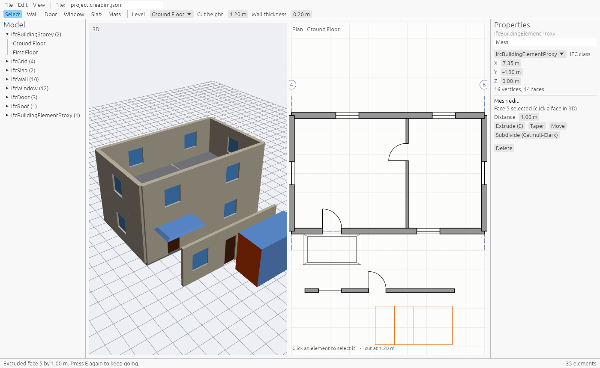

# CreaBIM

CreaBIM is an open-source, BIM-native architectural modeler: one model for freeform concept design and permit drawings, with Blender-style modeling, live 2D views and native IFC.



**Status: Phase 1 in progress (modifier stack, sketches, move, rotate and stretch).** It proves the core architecture end to end. It is not yet a tool for real projects.

## What works today

- **One model, many views.** The 3D view and the plan read the same element store. An edit in either shows up in both at once.
- **Views are model elements:** plans, sections and elevations live in the model, so they save, undo and update with it. Pick one from the *View* list or the *Views* group in the model list.
- **2D view in three places:** docked beside 3D, in its own window (for a second monitor), or overlaid inside the 3D workspace. *View → Show the 2D view in 3D space* draws a plan at its cut height, or a section standing on its section line.
- **Sheets with live views:** place plans, sections, elevations and 3D views on A0 to A4 sheets with a title block. Views on a sheet are generated from the current model, so they never go stale. Drag a view to move it; double-click it to work on the model right there, with the same tools as the view itself (orbit a 3D view by dragging). *File → Export sheets as PDF* writes every sheet as a vector PDF page.
- **Clean joins and materials:** wall corners are mitred and walls meeting another wall's side are trimmed to its face, in 3D, plans, sections and IFC. Walls cut through the slabs that sit in them. Each material has its own hatch pattern and colour, used for cut faces, shaded views and 3D, and exported to IFC.
- **Dimensions and tags:** draw dimensions that snap to wall corners, openings and levels. They stay attached, so moving a door updates its dimensions. Tag doors and windows with their marks (D01, W01) and walls with their material and thickness, one at a time or all at once.
- **Schedules:** door, window, wall and slab schedules are views too. Edit sizes and materials right in the table, place them on sheets and export them as CSV.
- **Shaded and cropped views:** 3D views and elevations can be shaded in material colours, on screen, on sheets and in the PDF. Crop any view on a sheet by dragging its crop frame.
- **Sections and elevations generated from the model:** cut walls, slabs and openings are drawn heavy; what lies beyond is projected with hidden lines removed. Level datums are labelled. Section and elevation marks appear in plans. Draw new ones with the *Section* and *Elevation* tools, in plans or inside another section, and drag a selected section line by its ends or middle. Walls, doors, windows, slabs and masses can be drawn in sections and elevations too. Progress screenshots are in [docs/evolution](docs/evolution).
- **BIM elements:** levels, grids, walls, slabs, doors and windows. Doors and windows are hosted by walls and cut real openings.
- **Freeform meshes:** add a mass, click a face in 3D and extrude (E), taper, move or subdivide it (Catmull-Clark). Give any mesh an IFC class such as `IfcRoof` and it exports as that.
- **Modifier stack:** give a mass array, mirror, solidify and subdivision modifiers. They change its shape without touching its mesh, so you can turn them off, reorder them or change their values at any time, and apply the top one to make it permanent. Faces stay clickable through the modifiers.
- **Sketches on workplanes:** the Sketch tool draws lines on any face in 3D, on a level in a plan, or on the section plane in a section. A closed sketch extrudes (E) into a mass; an open one into a surface that Solidify thickens.
- **Move, rotate, scale, duplicate and stretch:** G, R and S (and Shift+D to copy) work Blender-style on the selected element in 3D, plans and sections, with axis keys and typed values. In plans, drag a selected element to move it, or its square grips to stretch walls, slabs and grids; joined walls follow.
- **Undo and redo** for every edit. Dragging a value in the properties panel undoes as one step.
- **Plan drawings generated from the model:** walls cut at a set height, door swings, window symbols, slabs and masses in projection. Export as SVG at 1:100.
- **IFC4 export** with storeys, walls, slabs, openings, doors, windows and tessellated freeform elements. CI checks every export against the IFC schema and builds its geometry with [IfcOpenShell](https://ifcopenshell.org).

## Build and run

You need a recent stable Rust toolchain (1.95 or newer).

```sh
cargo run --release -p creabim-app   # the desktop app
cargo test --workspace               # the test suite
```

On Linux the app also needs a Vulkan or GL driver and `libxkbcommon-x11` at runtime. CI builds a Windows `.exe` on every pull request, downloadable from the run's artifacts.

### Command line

```sh
cargo run -p creabim-cli -- sample house.creabim.json            # write the sample house
cargo run -p creabim-cli -- save-db house.creabim.json house.creabim  # convert to a SQLite project file
# every command that reads a model accepts a .creabim or a .creabim.json file
cargo run -p creabim-cli -- ifc house.creabim.json house.ifc     # export IFC4
cargo run -p creabim-cli -- plan house.creabim.json "Ground Floor" gf.svg
cargo run -p creabim-cli -- views house.creabim.json             # list plans, sections, elevations
cargo run -p creabim-cli -- view house.creabim.json "Section A" a.svg
cargo run -p creabim-cli -- sheets house.creabim.json            # list sheets
cargo run -p creabim-cli -- pdf house.creabim.json house.pdf      # every sheet, one PDF
cargo run -p creabim-cli -- schedule house.creabim.json windows w.csv  # doors, windows, walls or slabs
python3 tools/validate_ifc.py house.ifc                          # needs: pip install ifcopenshell pytest
```

## Using the app

| Action | How |
| --- | --- |
| Orbit, pan, zoom (3D) | Left drag, right drag, wheel |
| Pan, zoom (plan) | Right drag, wheel |
| Draw walls | Wall tool, click points; Esc or right-click ends; Shift keeps it orthogonal |
| Doors, windows | Door or Window tool, click on a wall |
| Slab | Slab tool, click two corners. In a section, click the two ends of its edge: the top snaps to the nearest level |
| Section, elevation | In a plan: Section or Elevation tool, click two points; it looks to the left of the direction you draw. In a section: click where it cuts, then the side it looks towards |
| Move a section line | Select it in a plan, drag the square end handles or the round middle handle |
| Draw in a section | Wall: click two points (length along the line, height as drawn). Door, Window: click on a wall. Mass: click to place |
| Sheets | Pick a sheet from the View list. *Place view…* adds a view, drag to move it, double-click to edit through it, Esc to finish |
| Orbit a 3D view | Drag in it, on its own or on a sheet |
| Dimension | Dimension tool, click two points (they snap to corners and levels), then a third for the offset. Drag a selected dimension to move its line |
| Tag | Tag tool, click a door, window or wall. *Tag doors and windows* tags every untagged one in the view. Drag a tag to move it |
| Schedule | *File → New schedule*, then edit cells in the table. *Export CSV* saves it |
| Crop a view on a sheet | Select the viewport, drag the dashed frame's edge handles, or set the crop in Properties |
| Materials | Select a material in the model list to change its hatch and colour; pick a wall's or slab's material in Properties |
| Freeform mass | Mass tool, click to place; click a face in 3D, then E to extrude |
| Modifiers | Select a mass, then *Add modifier…* in Properties. Tick to turn one off; Up, Down, Remove; Apply bakes the top one into the mesh |
| Sketch | Sketch tool. In 3D, click a face to sketch on it (or the ground); in a plan or section, click on the drawing. Click corners; click the first corner to close it, Enter or right-click to leave it open. Shift keeps lines square. Then E extrudes it by the distance in Properties |
| Move, rotate, scale | Pointer over a view, selected element: G, R or S. Move the pointer or type a value; X, Y or Z keeps to an axis; Ctrl snaps; click or Enter finishes, Esc or right-click cancels. Shift+D copies first |
| Stretch, drag (plan) | Drag a selected element to move it, or its square grips: wall ends, slab corners and edge midpoints, grid ends |
| Undo, redo | Ctrl+Z, Ctrl+Shift+Z or Ctrl+Y |
| Delete | Delete key (also removes doors, windows, tags and dimensions attached to it) |

Files: *File → Save/Open* use the path in the toolbar (`.creabim.json`). *Export IFC4* and *Export view as SVG* write next to it.

## How it is built

| Crate | Role |
| --- | --- |
| `creabim-core` | Element store, edit transactions, undo history, Blender-style edit mesh, modifier stack, workplanes and transforms. Every edit is a reversible op, which later also powers version history and live collaboration. |
| `creabim-geom` | Element geometry (walls with openings, slabs, meshes), plan drawing generation, picking. This is where OpenCascade plugs in for NURBS and B-rep work. |
| `creabim-ifc` | IFC4 STEP writer. Element ids are IFC GlobalIds, so re-exports keep identity. |
| `creabim-store` | The `.creabim` project file: a SQLite database of the current elements plus the journal of every edit, so undo history survives closing the app. Records each edit incrementally (WAL) for cheap, crash-safe autosave. |
| `creabim-app` | Desktop app: egui UI, wgpu 3D viewport rendered offscreen so any number of live views can exist. |
| `creabim-cli` | Command-line export tools. |

Next steps follow the roadmap's Phase 1 plan: a SQLite project file with IFC import, then a Windows installer.

## License

CreaBIM is free software under the GNU General Public License v3.0 or later. See [LICENSE](LICENSE).
