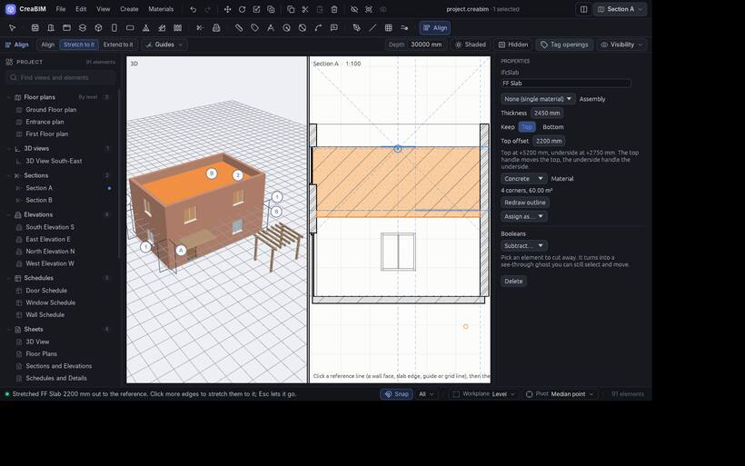

# Align, Extend and Stretch

The **Align** tool lines things up against a reference, the way Revit's Align does. It is the last icon in the tool row, and in *Edit › Align to a reference…* and the right-click menu of a 2D view.

It always works in two clicks: **first the reference, then what to change**. The reference stays picked, so you can line up several edges against it. `Esc` lets it go.

Pick the mode in the tool options strip.

## Align

1. Click a reference line: a wall face, a slab edge, a grid line, a guide or a temporary guide line.
2. Click the edge of what should line up with it.

The element turns parallel to the reference (the shorter way round) and moves flush against it. Clicking a door's or window's edge moves its wall.

## Extend to it

Click the reference, then near the end of a wall, beam or grid line: that end stretches to meet the reference. Walls joined to it follow.

## Stretch to it

Click the reference, then an edge: only that face moves to the reference, and the opposite face stays put. As you hover, the edge that Stretch will take is highlighted.

- In a section, click a slab's top under a line: the slab thickens to it. A wall's top changes its height. A column's top can stretch up to the underside of a beam.
- In a plan, a wall's end stretches like Extend.

The edge must be parallel to the reference.

## Where it works

Align, Extend and Stretch work in plans, sections and elevations. In the 3D view, use [Move face](move#move-a-face-push-and-pull) instead. Each click is one undo step.
