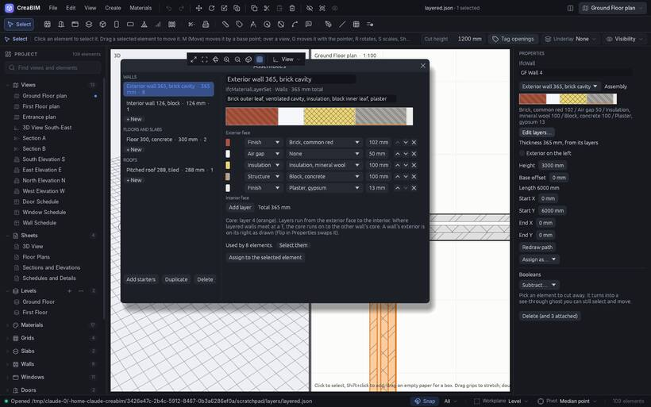

# Layered assemblies

Real walls, floors and roofs are made of layers: brick, cavity, insulation, block, plaster. An **assembly** is a named list of those layers, each with its material, thickness and function, kept in the project and shared by every element that uses it. Plans and sections hatch each layer in its material, and the 3D view shows one solid per layer.

## The Assemblies window

Open it with *Materials › Assemblies…*, or the **⋯** on the browser's *Assemblies* group.

- Assemblies are grouped as walls, floors and roofs.
- The layer table runs from the exterior face to the interior face: function, material and thickness, with buttons to reorder and remove layers.
- The preview shows the layers hatched, with the **core** (the structural layers) bracketed.
- Create, duplicate and delete assemblies, see how many elements use one, select them, or assign it to the selection.

*Materials › Add starter assemblies* adds an exterior brick cavity wall, an interior block wall, a concrete floor and a tiled pitched roof.

## Using one

Select walls, slabs or roofs, then pick an assembly with *Materials › Assign assembly* or the *Assembly* picker in *Properties*. The thickness comes from the layers. *None* goes back to a single material.

A wall's layers start at its exterior side; [flip](walls#inside-and-outside-flip) it to swap sides.

## Joins

Layered walls join layer by layer: L corners are mitred, and in a T the core runs on to the other wall's core.

## Doors and windows in layered walls

In 3D, the reveals round a door or window in a layered wall are lined with the wall's finishes: the outer finish on the outside part of the reveal, the inner finish on the inside part. So the insulation and membranes don't show where the opening cuts through them. The linings are only for the 3D view; drawings and exports show the layers as they are.
