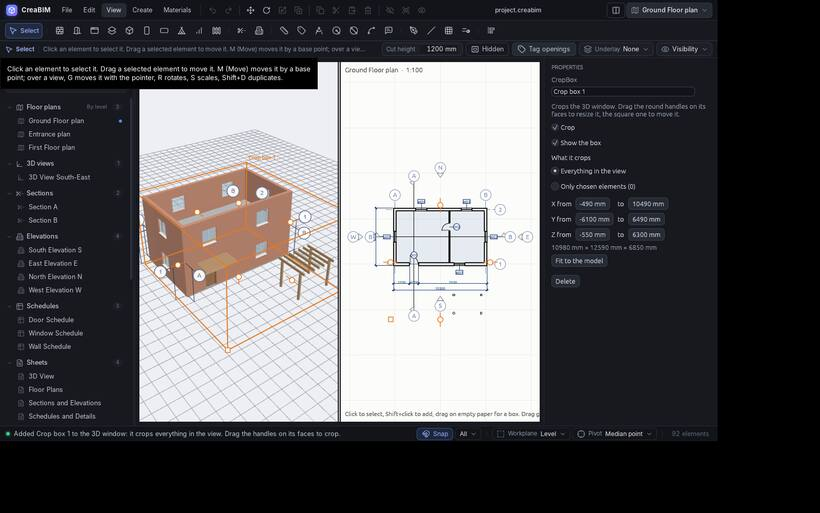

# Crop boxes

A **crop box** cuts a 3D view down to what is inside it, so you can see into the building: one floor, one room, a detail. It is like Revit's section box, with more:

- it can crop **everything**, or **only chosen elements**;
- a view can have **as many boxes** as you like; an element keeps only what is inside all the boxes that crop it;
- each box can be **switched off** (it stays but crops nothing) or **hidden** (its frame goes, but it still crops).

Cut faces are closed with a darker cap, so walls and slabs look solid, layer by layer.

## Adding one

- *View › Crop boxes › New crop box*: a box fitted round the whole model.
- *New crop box round the selection*: fitted round what is selected, cropping everything.
- *New crop box for the selection only*: crops only the selected elements.
- Or *Add crop box* in *Properties* with nothing selected, or the **+** on the browser's *Crop boxes* group.

## Shaping it

- Drag the round handles on its faces; they snap to the model.
- Drag the square handle at its corner to move it across the plan, or press `G`.
- Or type its extents in *Properties*: *X*, *Y* and *Z from … to …*, in project units. *Fit to the model* fits it again.

## Cropping only some elements

Set *What it crops › Only chosen elements*, click **Pick elements…**, then click elements in the 3D view to add them (again to leave one whole). Picking a wall takes its doors and windows. `Esc`, right-click or **Done picking** ends.

## Managing boxes

With nothing selected, *Properties* lists the boxes, each with *Crop*, *Show the box*, its name and *Delete*. *View › Crop boxes* lists them with on/off ticks.

## Whose boxes

When a saved 3D view is open in the 2D pane, the 3D window shows and edits that view's crop boxes, and the view's drawing (and every sheet it is on) is cropped the same way. Otherwise the 3D window uses its own boxes.

Crop boxes only affect 3D views. Exports (IFC, glTF, FreeCAD) are never cropped.
