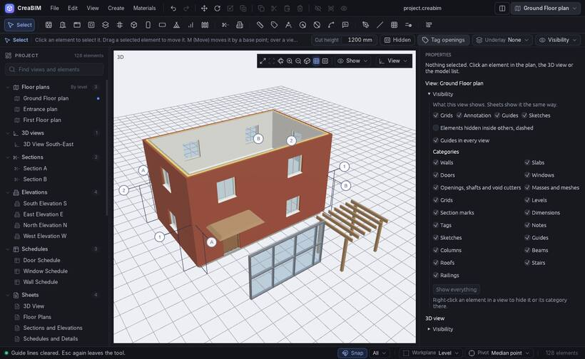

# Curtain walls

A **curtain wall** is a wall made of a grid of mullions holding glass or solid panels: a shopfront, a glazed façade.

## Drawing one

Use *Create › Curtain wall*: it starts the Wall tool with a curtain wall type. Or pick any curtain wall type in the Wall tool's **Type** menu. Then draw it like any wall.

## Its grid

Select it. Under *Curtain wall* in *Properties*:

- **Along**: the bays along the wall, by count or by spacing;
- **Up**: the rows up the wall, by count or by spacing;
- the mullions' width and depth;
- glass or solid panels, and the panel thickness.

These usually come from its [type](types), so changing the type changes every curtain wall of it.

## Set in a wall

Draw a curtain wall along a wall, or move one into it, and it cuts its own opening there, like a door or window: the wall loses the curtain wall's length and height. The opening follows the curtain wall when you move it, and closes again when it leaves the wall. *Properties* says which wall it is set in. In IFC the wall gets an `IfcOpeningElement` that the curtain wall fills.

A curtain wall drawn on its own stands alone, as before.

## Doors in it

Place a door or window on a curtain wall like on any wall: it sits in a panel.

Curtain walls are drawn in plans, sections, elevations and 3D, and export to IFC as `IfcCurtainWall` with its mullions and panels.
