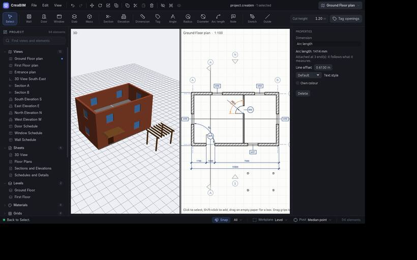

# Dimensions

Dimensions measure the model. Their points stick to what they measure (wall corners, door and window edges, levels, grids, columns, masses), so they update when it moves.

## Linear dimensions

1. Pick the **Dimension** tool.
2. Click two points to measure. They snap to corners and edges.
3. Click where the dimension line goes.

In the tool options choose the direction:

- **Auto**: from where you drag the line. Beside both points it measures vertically, above or below them horizontally, otherwise along the two points. Hold `Shift` to keep the one shown.
- **Aligned**: the true distance between the points.
- **Horizontal** or **Vertical**: the distance across or up the drawing.

A placed dimension's *Measures* in *Properties* changes it later. Drag a selected dimension to move its line.

## Angles

Pick the **Angle** tool. Click two lines (wall faces, edges), then where the arc goes. Or click the corner and one point on each arm. The side you place the arc on picks the inside or outside angle.

## Radius and diameter

Pick **Radius** or **Diameter**. Click an arc or circle (a door swing, a sketch arc), or three points on one, then where the dimension goes.

## Arc length

Pick **Arc length**. Click an arc, or its start, a point on it and its end, then where the dimension goes.

## How they look

Pick a **Style** in the tool options for new dimensions; change a placed one's style or *Own colour* in *Properties*. See [Annotation styles](styles).

## Breaking around tags

A style with **Break dimension lines at tags** on leaves a gap in its dimension lines wherever a tag's bubble or a note's text sits across them, so a chain of dimensions stays readable past the door tags on it. Dimensions in other styles run straight through.

To write the height of a point rather than a distance, use a [spot level](spot-levels).

Dimensions work in plans, sections and elevations, show on sheets and print in PDF and SVG.
