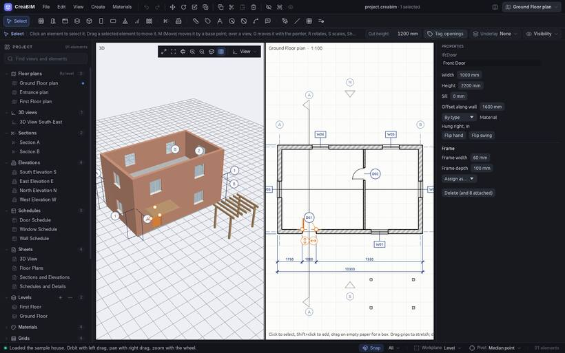

# Doors and windows

Doors and windows are hosted by a wall: they cut their opening in it and move with it.

## Placing them

Pick the **Door** or **Window** tool and click on a wall, in a plan, a section, an elevation or 3D. Pick a **Type** in the tool options to place a door or window of that type.

## Changing them

Select one, then:

- set its *Width*, *Height* and *Sill* (the height of its bottom edge above the wall's base) in *Properties*;
- drag it along its wall to move it (it stays in the wall);
- drag its jamb handles to widen it, or its head and sill handles to change its height, in a plan or in 3D;
- pick a material, and its frame: *Frame width* and *Frame depth*, and for windows *Panes across* and *Panes up*.

## Flip, hand and swing

A door has a **hand** (which jamb the hinges are on) and a **swing** (which side it opens to). *Properties* reads, for example, *Hung right, in*.

- `Space`, or the arrow across the wall, flips the swing.
- `Shift+Space`, or the arrow along the wall, flips the hand.
- A window flips inside and outside with `Space` or its arrow.

## Tags and schedules

The **Tag** tool labels a door or window with its mark (D01, W01). *Tag openings* in the top bar tags all of them in the view at once. A door or window schedule lists them all, and you can edit sizes in the table. See [Tags](tags) and [Schedules](schedules).

## Holes with nothing in them

For a bare hole in a wall, use the **Wall opening** tool. See [Holes, wall openings and shafts](holes).
