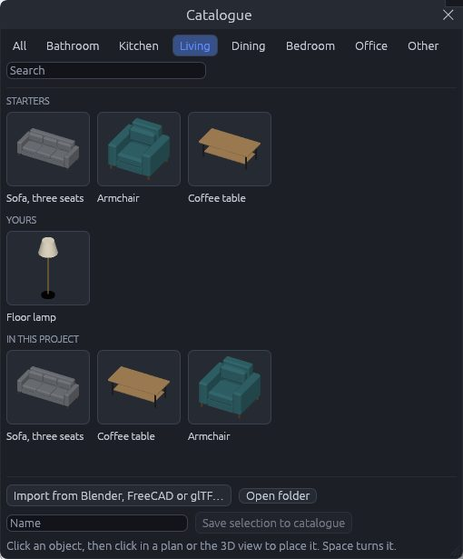
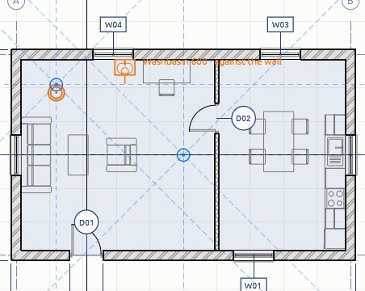

# Furniture and fixtures

Furniture and fixtures are objects you place in a building rather than build: basins, WCs, baths, showers, kitchen units, sofas, chairs, tables, beds, wardrobes and desks, and the sockets, switches, lights, radiators and other [electrical, plumbing and HVAC fixtures](fixtures). Every object is an instance of an **object type**. The type holds the shape (its parts, each in a material), its category, its IFC class, whether it stands against a wall, on its own or hangs from the ceiling, and the height new ones go in at. The object itself only knows where it is, how it is turned and how far above its level it sits.

To try it out, open *File › New furnished sample house*.

## The Catalogue window

Open it with *Create › Catalogue…*, with the sofa tool on the toolbar, or with **+** on the browser's *Furniture and fixtures* group.

- Pick a category along the top (Bathroom, Kitchen, Living, Dining, Bedroom, Office, Electrical, Lighting, Plumbing, Heating and ventilation, Other), or search by name.
- **Starters** are the objects CreaBIM comes with.
- **Yours** are the objects you imported or saved. They are kept for every project.
- **In this project** are the project's own object types, including any read from an IFC file.
- Click a picture to place that object. Right-click one of yours to delete it from your catalogue. Objects already placed from it stay.

## Placing objects

With an object picked, the **Object** tool is on. The object follows the pointer in the plan and in 3D, and a click places it.

- Basins, WCs, baths, showers, kitchen units, beds, sofas and desks **back onto the nearest wall** within 600 mm. They turn so their back is on the wall's face.
- Free-standing objects, such as tables, chairs and armchairs, go where you click. They are turned as the tool options say.
- Lights, diffusers and smoke detectors hang from the ceiling, centred where you click. See [Electrical, plumbing and HVAC fixtures](fixtures).
- Each goes in at its type's height: a wall cabinet at 1450 mm, a socket at 300 mm.
- **Space** turns the next object a quarter. *Turn* sets any angle, *Turn 90°* adds a quarter, and *Free of walls* places even wall-standing objects where you click.
- Keep clicking to place more; **Esc** ends.

Plans draw each object's plan symbol. A wall cabinet above the cut height is drawn as hidden lines. Sections, elevations and 3D show its full shape in its materials.

## Changing an object

Select it. In *Properties*:

- **Above its level** raises it, for example a wall cabinet or a wall-hung basin. For something hung from the ceiling it reads **Below the ceiling**. **Turn** turns it, and *Turn 90°* adds a quarter.
- The **Type** picker swaps it for another object type, so a chair can become an armchair. An object always has a type.
- Below them are its type's **category**, how it is **placed** (*Against a wall*, *Free-standing* or *From the ceiling*), the height **new ones** go in at, its **IFC class and predefined type**, and each **part's material**. Changing these changes every object of that type.

Move, rotate and duplicate objects like any element. An object keeps its type's shape, so the Move tool's face mode and [Align](align)'s *Stretch* move the whole object. Pushing a side face slides it, and pushing its top or bottom raises or lowers it. Aligning a sofa's back to a wall therefore puts it flush.

Object types are listed in the [Types](types) window under *Objects*. Deleting a type deletes its objects too, and Ctrl+Z brings them back.

## Your own objects

- **From Blender, FreeCAD or glTF:** in the Catalogue window, *Import from Blender, FreeCAD or glTF…* reads a `.blend`, `.FCStd`, `.gltf` or `.glb` file as one object. Each mesh becomes a part in its own material. The object is set on the floor with the middle of its back edge at the origin, so model it facing −Y (Blender's front view). Its category, IFC class and placement are guessed from the file's and the meshes' names, such as "sink", "toilet", "sofa", "bed" or "desk". An `ifc_class` custom property in Blender, or an IFC type in FreeCAD, takes precedence. Check the guess in Properties after placing it.
- **From the model:** select an object, some masses or any elements, type a name and click *Save selection to catalogue*. An object saves its type; anything else is saved as its 3D shape in its colours.

Your catalogue is a folder of `.json` files, one per object, in `CreaBIM/catalogue` in your settings folder (`%APPDATA%` on Windows, `~/.config` elsewhere). Copy them to share objects. A project file carries the types of the objects placed in it, so it opens the same on any computer.

From a terminal, `creabim catalogue-import chair.blend <folder>` does the same import, and `creabim catalogue` lists the starters.

## IFC

Objects export as IfcFurniture, IfcSanitaryTerminal, IfcElectricAppliance or IfcSystemFurnitureElement (fixtures as IfcOutlet, IfcLightFixture, IfcSpaceHeater and the others listed in [fixtures](fixtures)), typed by their IfcFurnitureType, IfcSanitaryTerminalType and so on, with predefined types such as SOFA, BED, WASHHANDBASIN, TOILETPAN, SINK or FRIDGE_FREEZER. Each type carries its shape once, as a *Body* representation map with each part in its material, and its plan symbol as a *FootPrint* map. Every object refers to those maps. Opening such a file brings the types and objects back. See [IFC](ifc).
