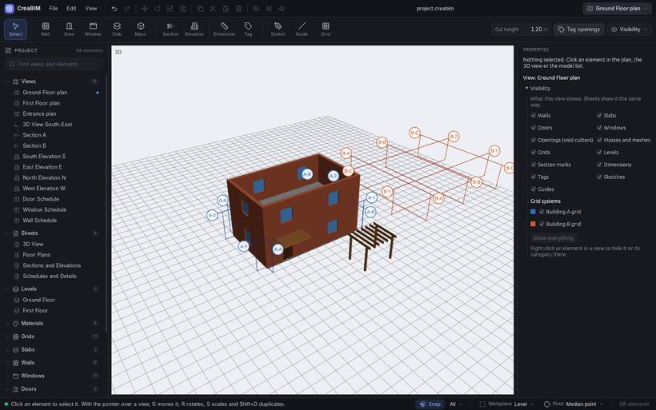

# Grids

**Grid lines** are the labelled reference lines that structure a building: A, B, C one way and 1, 2, 3 the other. Columns and walls are placed on them, and everything snaps to them.

## Drawing grid lines

1. Pick the **Grid** tool.
2. Click two points for each line. `Shift` keeps it straight.

Each line takes the next label of its direction. Lines show in plans, sections and in 3D, with bubbles at their ends.

## Grid systems

A project with several buildings can have a **grid system** for each, with its own prefix ("A-", "B-"), labels and colour.

- The Grid tool's *Grid system* menu in the top bar picks the active system, makes a new one, renumbers the lines in order, selects its lines, moves selected lines into a system, and opens *Edit the grid system…*.
- A grid system's *Properties*: name, prefix, how its north–south and east–west lines are counted, colour.

Changing the prefix relabels the whole system.

## Moving grid lines

Select a line in a plan and drag its grips, or pick it in 3D by its bubble or a line and drag it square to itself. [Extend](align#extend-to-it) stretches a grid line's end to a reference.

## Hiding grids

Each view's [visibility](visibility) can hide grids, or a single grid system. *Show* in the 3D view's buttons does the same for 3D.
