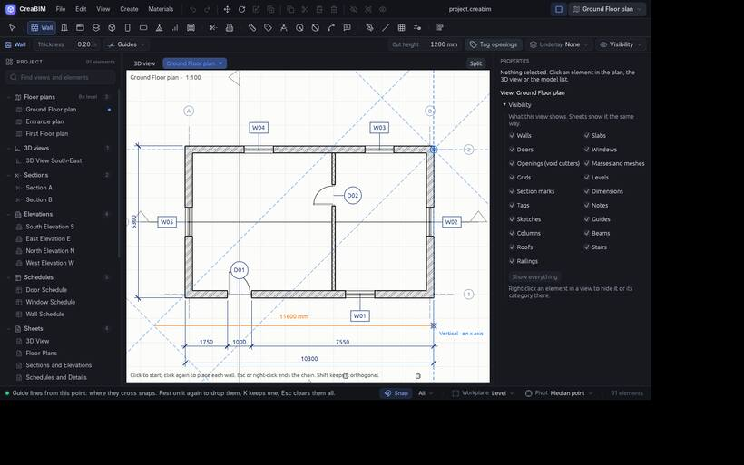

# Guides

## Temporary guide lines

While a drawing tool is active, any point or edge can send out dashed guide lines to help you line up, like tracking in other CAD programs.

1. Hold the pointer still on a point or an edge for about half a second, or press `Q` over it. A small blue marker shows it is **rested**.
2. It gives guide lines:
   - a point: level and plumb lines, and lines at each angle step (45° by default);
   - an edge: its extension, and perpendiculars at its ends;
   - once you have clicked a first point: parallels and perpendiculars through it, and angles from it;
   - an arc or circle: its circle, radials and tangents.
3. The pointer snaps to the guide lines, and most of all to where two cross. The label names them, such as *Extension · Perpendicular*.
4. Rest on the same item again to drop it.

- `Esc` with no clicks pending clears every guide line.
- `K` keeps the straight guide line under the pointer as a real guide.
- The **Guides** menu in the tool options turns guide lines on and off, picks the angle step (level and plumb only, 15°, 30° or 45°) and clears them.

They work in plans, sections and elevations.

## The Guide tool

**Guides** are construction lines kept in the model: dashed, snapped to, never printed or exported.

- Pick the **Guide** tool and click two points for a guide through them.
- Or click an edge, then click where its parallel guide goes.

In 3D, guides go on the [workplane](sketches#the-workplane); in a section, on the section plane.

*View › Guides* (`Shift+G`) hides all guides in every view without deleting them.
