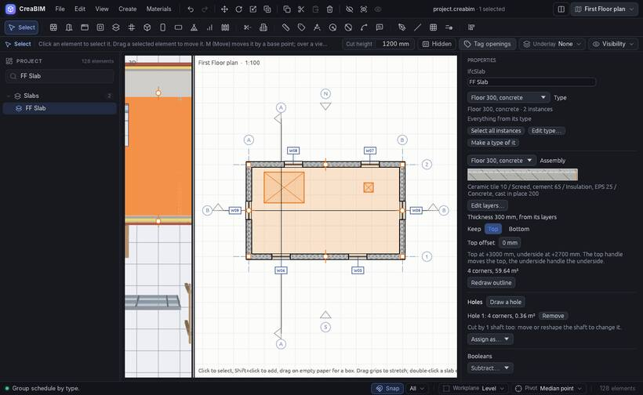

# Holes, wall openings and shafts

Three ways to cut a hole in the building, each exported to IFC as an opening.

## Wall openings

A **wall opening** is a rectangular hole in a wall with no door or window in it, for a duct or a pass-through.

1. Pick the **Wall opening** tool (*Create › Wall opening*).
2. Click on a wall.
3. Set its width, height and sill in *Properties*.

## Holes in slabs and roofs

1. Select a slab or a roof.
2. Click **Draw a hole** under *Holes* in *Properties*.
3. Draw the hole's outline, with lines or arcs, snapping as usual.

The hole is cut in plan and in 3D, and the area updates. *Properties* lists the slab's holes, each with *Remove*.

## Shafts

A **shaft** is a vertical hole through every slab and roof between two levels: a stair well, a lift, a riser.

1. Pick the **Shaft** tool.
2. Draw its outline like a slab: `1` Polygon, `2` Rectangle, `3` Fill room or `4` From sketch.

By default it runs from this level to the next one up. Set its base and top levels and offsets in *Properties*. Move it and every hole it cuts moves with it.
