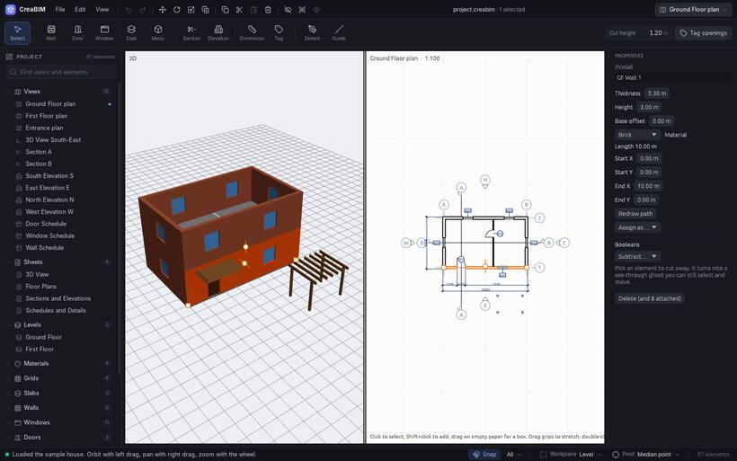
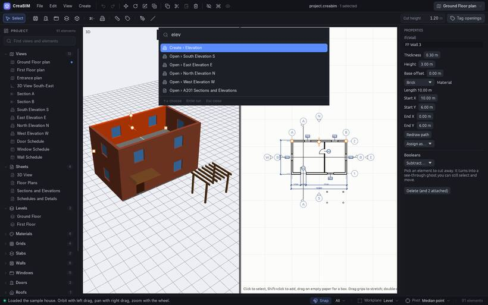

# The window at a glance

## The top bar

- **Menus**: *File*, *Edit*, *View*, *Create*, *Materials* and *Help*. While one is open, slide to the next to switch.
- **Quick buttons**: Undo, Redo, Move, Rotate, Scale, Duplicate, Copy, Cut, Paste, Delete, Hide, Show only selected, Show everything. They do the same as the keys, so everything can be done with the mouse alone.
- **The file name**, and how many elements are selected.
- **The view switcher** (top right): every view and sheet; pick one to open it in the 2D view. The square button beside it switches between one view at a time and the 3D view beside the drawing.

## The tool row

The tools, grouped: selecting, building elements (wall, door, window, slab…), views (section, elevation), annotation (dimension, tag, note…), and sketching and guides. Hover a tool for its name and how to use it. *Create* lists the same tools by name.

## The tool options strip

The row under the tools shows the tool in use and what it can be set to: a wall's thickness, a slab's drawing mode, a dimension's direction. Fields keep a short label; switches and buttons are small icons. Hover one for its name, its key and what it does.

After a divider come the settings of the open view: cut height, depth, *Style*, *Hidden*, *X-ray*, visibility.

When the window is too narrow for all of it, what does not fit goes into **⋯ More** at the right end, view settings first. Nothing is ever pushed out of sight.

The **?** beside the tool's name opens a few lines on how to use it, with **Read more** for its page in this guide.

## The project browser (left)

Everything in the project, grouped: views by kind, sheets, levels, then walls, doors, materials, types and so on. Type in its search box to filter. Click a row to select it, or to open a view or sheet. Double-click an element to zoom to it, or a type to see it on its own. `Shift` or `Ctrl` adds to the selection. Drag a view up or down to reorder its group. The button at the top folds every group shut, or opens them all. Drag the panel's edge to widen it.

## The views (middle)

The 3D view and the 2D view. The 2D view shows a plan, a section, an elevation, a 3D view, a schedule or a sheet. You can draw and select in all of them. See [Views](views) and [Moving around the views](navigate).

## Properties (right)

Everything about what is selected: sizes, materials, levels, type, and buttons for what can be done with it. With nothing selected, it shows the open view's settings. Drag a number's label sideways to change it, or click and type. Lengths can be typed in any unit (`1200`, `1.2 m`, `4'`).

It reads from the top down: what the element is (its class, name and type), then its sizes and build, then how views show it. Click a section's heading to fold it; it stays folded, also next time. The **?** beside a heading says in a few lines what it is about. Drag the panel's left edge to make it as wide as you like: it keeps that width, and what does not fit wraps or goes to one column instead of pushing it wider.

## The status bar (bottom)

What to do next, in words, on the left. Then the **Snap** switch and the list of snaps, the **Workplane** and the **Pivot** for rotating and scaling.

## The Help panel

This panel. It opens at the right of the window, beside your work. Drag its left edge to widen it, search with the box at the top, go back with the arrow, and close it with **×**, `Esc` or `F1`.

## Themes and the command palette

- *View › Theme* picks a colour theme: Graphite, Paper, Blueprint, Sage, Ink, Dark or Light. `Ctrl+Shift+T` goes to the next one. The choice is remembered.
- `Ctrl+K` opens the **command palette**: type part of any command, tool, view, help page or element name, then `Enter`. An element is selected and zoomed to.

- *View › Classic panels* switches to plain built-in panels, for computers where the new interface can't start.
