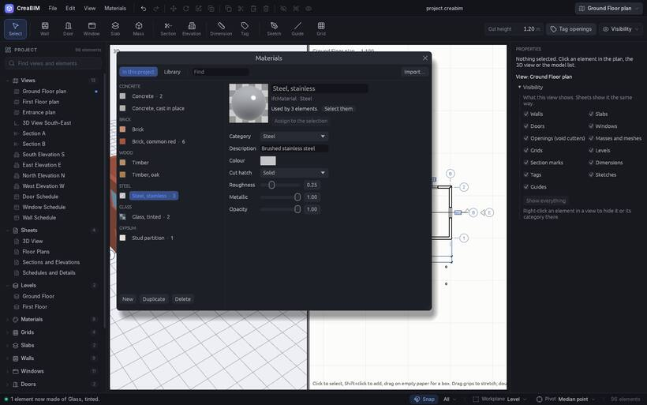

# Materials

A **material** is what an element is made of: concrete, brick, timber, glass. It has a colour, a **cut hatch** (the pattern drawn where a section cuts through it) and a surface (how rough, metallic or see-through it looks in 3D). Materials are exported to IFC with the elements.

## The material library

CreaBIM comes with 52 common building materials in 17 categories. *Materials › Add from the library* adds one, or a whole category with *Add them all*. The material browser's *Library* tab shows them with descriptions.

## The material browser

*Materials › Material browser…* lists the project's materials by category, with how many elements use each.

- Add, duplicate, rename and edit materials, with a live preview ball.
- *Select them* selects the elements that use a material; *Assign to the selection* gives it to the selection.
- *Delete* asks what the elements still using it should be made of instead.

Selecting a material in the project browser shows the same editor in *Properties*.

## Giving an element a material

Select it, then pick the material in *Properties*, or use *Materials › Assign material*. This works for walls, slabs, roofs, masses, doors, windows, columns, beams, stairs and railings. Layered walls, floors and roofs get their materials from their [assembly](assemblies).

## Importing materials

*Materials › Import materials…* reads materials from IFC files, FreeCAD material cards (`.FCMat`), glTF files (`.gltf`, `.glb`) and Blender files (`.blend`). A material whose name the project already has is updated, so its elements follow.
