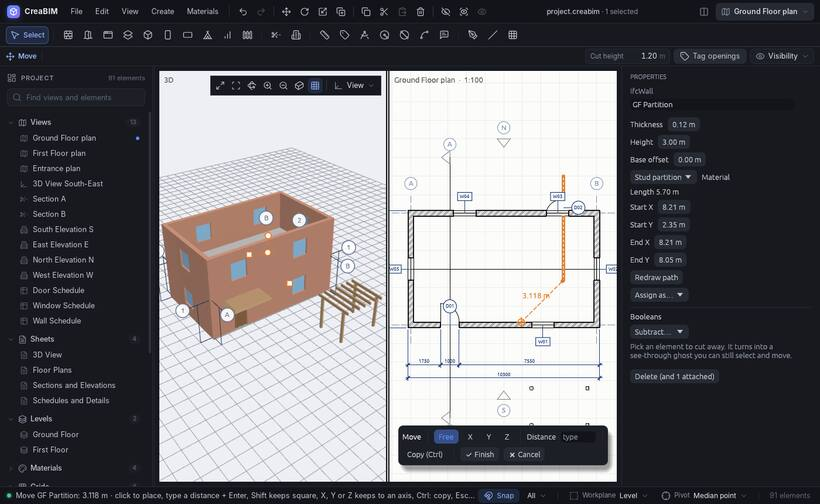

# Move, rotate and scale

## Move by a base point

The most precise way to move something, as in most CAD programs.

1. Select what to move, then press `M` (or the Move button, *Edit › Move*, or the right-click menu). With nothing selected, Move asks you to click what to move first.
2. **Base point**: click a point to move it by, such as a corner. A snap marker shows what you will catch. Nothing moves yet.
3. **Follow**: the selection follows the pointer, with a dashed line showing the distance.
4. **Place**: click where the base point should go. It snaps to corners, midpoints, crossings and grid lines.

While it follows the pointer:

- Type a distance, such as `2400`, `2.4 m` or `8'-6"`, and press `Enter`: it moves that far in the direction you point. A bare number is in the project's units.
- Press `X`, `Y` or `Z` to keep to that axis; again to free it. Hold `Shift` to keep it square.
- Press `Ctrl` to leave a copy behind with every click.
- `Esc` or right-click steps back, and again cancels.

The panel at the bottom of the view does the same with the mouse: *Free*, *X*, *Y*, *Z*, a distance box, *Copy*, *Finish* and *Cancel*.

A move is one undo step. Doors and windows go with their wall, and walls joined to a moved wall stretch to stay joined.

## Move a face (push and pull)

Press `F` during Move (or click **Face** on the Move panel) to move one face of an element instead of all of it.

- In 3D, point at the face itself. In a plan or section, point at the element's edge: it stands for the face square to the paper.
- Click, then move the pointer or type a distance. A minus sign pulls the face in.

What it changes depends on the face: a wall's end changes its length, its top its height and its side its thickness; a slab's top its thickness; a door's jamb its width; a column's side its size; a mass's face moves its points. Press `F` again for whole elements.

## Grab with the pointer: G

With the pointer over a view, `G` grabs the selection and it follows the pointer straight away, from the snapped point under the pointer. Click or `Enter` to finish. Axis keys, typed values and `Esc` work as in Move.

## Drag

Press on a selected element and drag it. Its grab point and where it lands both snap. A small movement doesn't count, so a click never moves anything. See also [Handles and grips](handles).

## Rotate: R

1. Select, then click *Rotate* or press `R` over a view.
2. Click the **centre**, then a **reference direction**, then the **new direction**. Each snaps.
3. Or type an angle, such as `30`, and press `Enter`.

Press `R`, then `X` or `Y`, to tilt a mass about that axis. In a section, R tilts about the axis you look along. Walls and slabs stay upright.

## Scale: S

`S` over a view scales the selection with the pointer, or by a typed factor. Press `X`, `Y` or `Z` to scale along one axis only: a wall changes its height, a slab its thickness.

## Duplicate: Shift+D

`Shift+D` copies the selection and starts moving the copy.

## The pivot

Rotate and scale turn about the **pivot**, chosen in the status bar or *Edit › Pivot*: the median point, the bounds' centre, each element's own origin, the active element, or the **pivot cursor**. `Shift+right-click` anywhere places the cursor and makes it the pivot.

## Extrude: E

Select a face of a mass in 3D, or a closed [sketch](sketches), and press `E` to extrude it.
