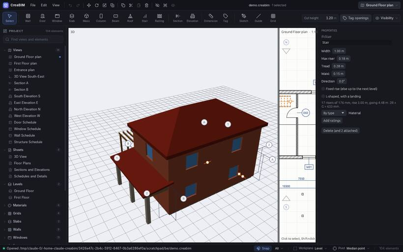

# Roofs

## Drawing a roof

1. Pick the **Roof** tool.
2. In the tool options choose its shape and its **Pitch** (slope, in degrees):
   - **Flat**
   - **Mono-pitch**: one slope
   - **Gable**: two slopes meeting at a ridge, with gable ends
   - **Hip**: slopes on every side
3. Draw its outline like a slab: `1` Polygon, `2` Rectangle, `3` Fill room, `4` From sketch.

## Changing a roof

In *Properties*:

- the shape and pitch;
- the overhang past the outline;
- **Base offset**: how high the eaves sit above the level, such as 3.00 m to sit on a storey's walls;
- **Eave edge** and **Next edge**: which edge is the eave of a mono-pitch roof, or which edges are gable ends;
- its thickness, material or [assembly](assemblies), and its holes.

The summary line gives the corners, the area including the overhang and the roof's height.

## Walls under a roof

Select walls and use *Attach top to roof/slab*: their tops follow the roof's underside, cut to its slope. See [Walls](walls#base-and-top).

> **Note:** Gable and hip roofs need a convex outline (no inward corners). On an L-shaped outline the roof stays flat, and *Properties* says so.
