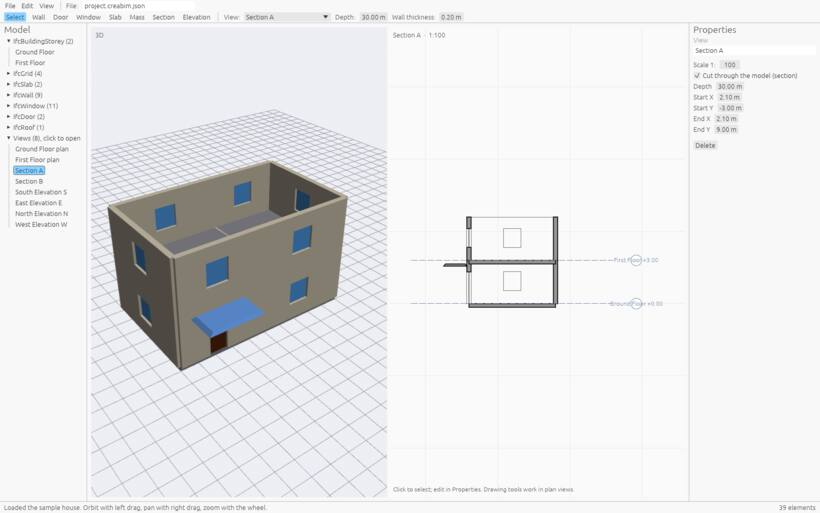

# Sections and elevations

A **section** cuts the building along a line and shows what you see looking one way: cut walls and slabs heavy and hatched, what lies beyond in thinner lines. An **elevation** is the same seen from outside the building, without cutting it.

## Drawing one

In a plan:

1. Pick the **Section** tool (or **Elevation**).
2. Click two points. The view looks to the **left** of the direction you draw. Draw elevations outside the building.

In another section, click where the new section cuts, then click on the side it should look towards.

The new view appears in the project browser under *Sections* or *Elevations*, and its mark (A, B or N, E, S, W) shows in the plans.

## Moving the line and its depth

Select the mark in a plan by its arrow or its bubble:

- drag the square handles to move one end, or the round middle handle to move the whole line;
- drag the round handle on the shaded band to set its **depth**, how far it sees. The depth is also in the tool options strip.

## Flipping it

To look the other way along the same line, select the mark and:

- click its flip arrow,
- press `Space`,
- or right-click and choose *Flip view direction*.

The view is drawn again from the other side. Notes and free dimension points in it are mirrored so they stay over the same parts of the building.

## Drawing in a section

Walls, doors, windows, slabs, masses, levels, guides, sketches and dimensions can all be drawn right in a section or elevation. Selected elements show grips that slide along the section line and up and down.

## Seeing it in 3D

*View › Show the 2D view in 3D space* stands the section on its line in the 3D view.

## Hidden things

Elements hidden behind or inside others (a beam in a wall, a slab behind a façade) can be drawn dashed with *Hidden*, and seen through with *X-ray*. See [Visibility](visibility).
