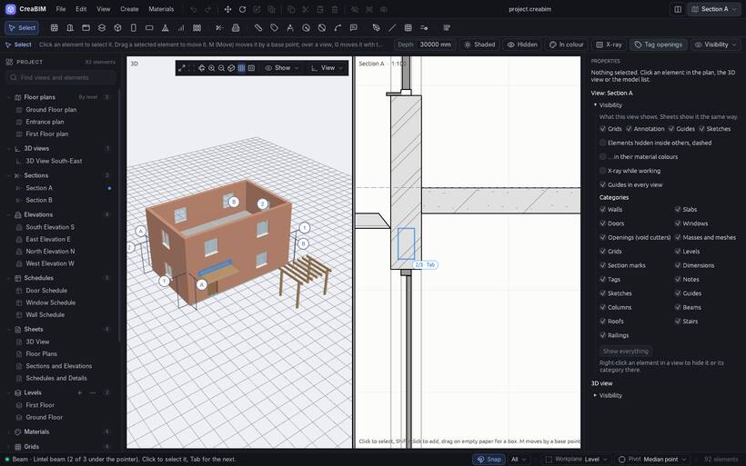
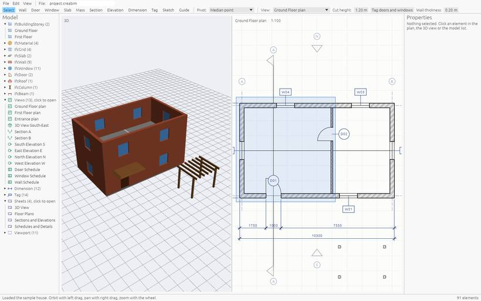

# Selecting

The **Select** tool (the arrow, first in the tool row) is where you are most of the time. With it you pick elements to look at, change, move or delete. Press `Esc` twice in any other tool to come back to it.

## Click to select

- Click an element in any view: 3D, plan, section, elevation, or a view on a sheet. It turns orange in every view, and *Properties* on the right shows its settings.
- `Shift+click` adds an element to the selection, or takes it away again.
- Click on empty space to select nothing. `Alt+A` does the same, and `Ctrl+A` selects everything.
- Click a row in the project browser to select that element. `Shift` or `Ctrl` adds to it.

The status bar counts what is selected, by kind ("5 selected: 2 windows, 2 walls, 1 tag"). With several selected, Delete, Move, Copy and Hide act on all of them, and *Properties* shows the one picked last.

## Hover first

Before you click, the element under the pointer lights up in a quiet blue, in every open view. That is what a click will take.

## Picking what is underneath

Sometimes several elements are under the pointer: a beam inside a wall, a column behind a slab edge. Then a small badge by the pointer counts them, such as **1/3 · Tab**.

- Press `Tab` to move the highlight to the next one, and `Shift+Tab` to go back. The status bar names the one highlighted ("Beam · Lintel beam (2 of 3 under the pointer)"). Click to select it.
- Or click the badge: a short list names every element under the pointer. Hover a row to see which it is, and click it to select it.

A plain click without `Tab` takes what it always took. In an elevation this also reaches what is behind the face you see, such as a slab behind a wall.

For hidden elements you need to work on for a while, [X-ray](visibility#x-ray) (`Alt+Z`) makes walls and slabs faint and puts what is inside them first.

## Select with a box

- In a plan or section, drag on empty paper.
- In 3D, press `B`, then drag.

Dragged **left to right** (solid blue), the box takes only what lies wholly inside it. Dragged **right to left** (dashed green), it takes everything it touches. Hold `Shift` to add to what is already selected.

## Selecting by type or material

- *Select all instances* in *Properties* selects every element of the same [type](types).
- The [material browser](materials) selects every element made of a material.
- Clicking a heading in a schedule grouped by type selects all of its rows.

## The right-click menu

Right-click an element (or empty space) with the Select tool for what can be done right there: move, rotate, copy, delete, hide, flip a wall, *Hide in view*, set the pivot or the workplane. See [Copy, paste, delete and undo](edit).
