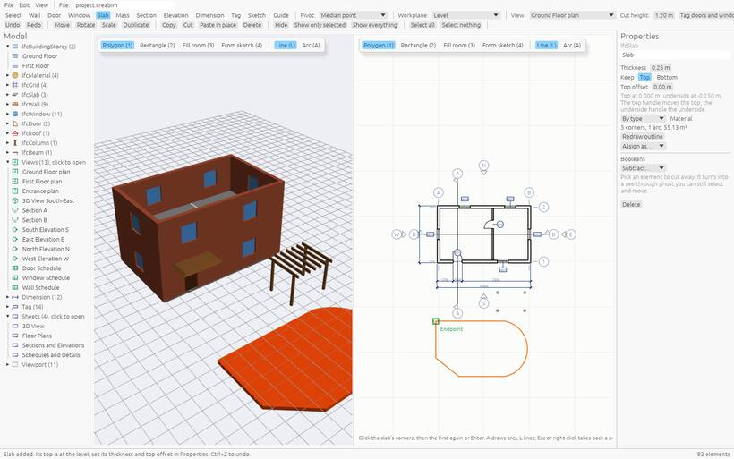

# Slabs

A **slab** is a floor, a ceiling, a terrace or a balcony: a flat plate on a level, drawn from its outline.

## Drawing a slab

Pick the **Slab** tool, then a mode in the tool options (or its number key):

- **Polygon** (`1`): click each corner, then the first corner again or `Enter`. Press `A` for an arc (click its end, then a point it passes through) and `L` to go back to straight lines.
- **Rectangle** (`2`): click two opposite corners.
- **Fill room** (`3`): click inside a room; the slab fills it to the walls.
- **From sketch** (`4`): click a closed [sketch](sketches).

`Esc` or right-click takes back the last point, and again leaves the tool. Corners line up with earlier ones: dashed lines show when the pointer is level with or plumb under a corner.

In a section, click the two ends of the slab's edge: its top snaps to the nearest level.

## Changing a slab

- Drag its corner and edge grips. Double-click an edge's grip to add a corner there, a corner to remove it.
- *Properties*: thickness, material or assembly, *Top offset*, and *Keep: Top / Bottom* (which face stays put when the thickness changes).
- *Redraw outline* to click a new outline.
- In a section, use [Stretch](align#stretch-to-it) or [Move face](move#move-a-face-push-and-pull) on its top or underside.

## Holes

*Draw a hole* in *Properties* cuts a hole in it; a [shaft](holes#shafts) cuts every slab it passes. See [Holes](holes).
