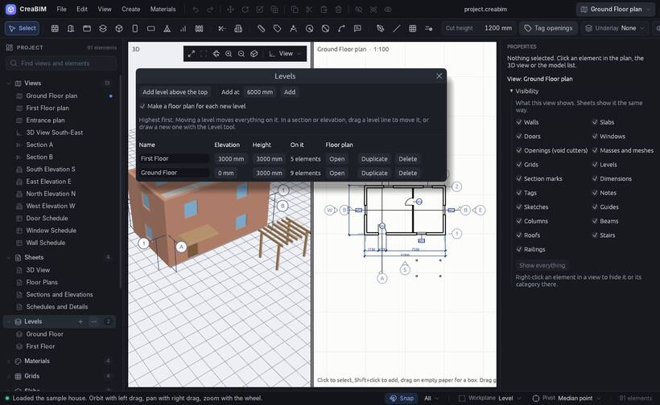

# Step 2: set up the levels

A **level** is a floor of the building: the ground floor, the first floor, the roof. It has a height (its *elevation*, such as +3000 mm). Walls, slabs and everything else stand on a level, so when a level moves, what is on it moves too.

## Add a level

1. Open the Levels window: *View › Levels…*, or the **⋯** button on the *Levels* group in the project browser on the left.
2. Click **Add level above the top**. A new level appears one storey up, with its own floor plan.
3. Click a level's name to rename it, and type its elevation to change its height.

The **+** on the *Levels* group, or *Create › Level above the top one*, adds a level in one click.

## Work on a level

Open a level's floor plan from the project browser (under *Floor plans*) or the view switcher at the top right. New walls and floors go on the level of the plan you draw in.

More about levels, including drawing them in a section: [Levels](levels).

**Next:** [Draw the walls](start-walls)
