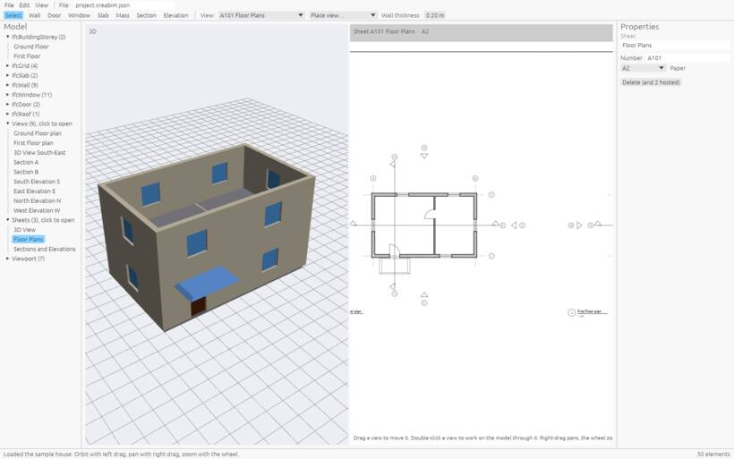

# Step 7: put it on a sheet

A **sheet** is a page of paper (A0 to A4) with a title block. You place views on it, and they stay live: if the model changes, the sheet changes.

1. Pick *File › New sheet* (or *Create › Sheet*). The new sheet opens in the 2D view.
2. In the top bar, click **Place view…** and pick the floor plan. Then place the section the same way.
3. Drag a view to move it on the paper.
4. Double-click a view to work on the model through it. Press `Esc` to finish.

Each view keeps its own scale (1:100, 1:50…), set in its *Properties*. Fill in the title block in the sheet's *Properties*. See [Sheets and title blocks](sheets).

**Next:** [Save and export](start-export)
