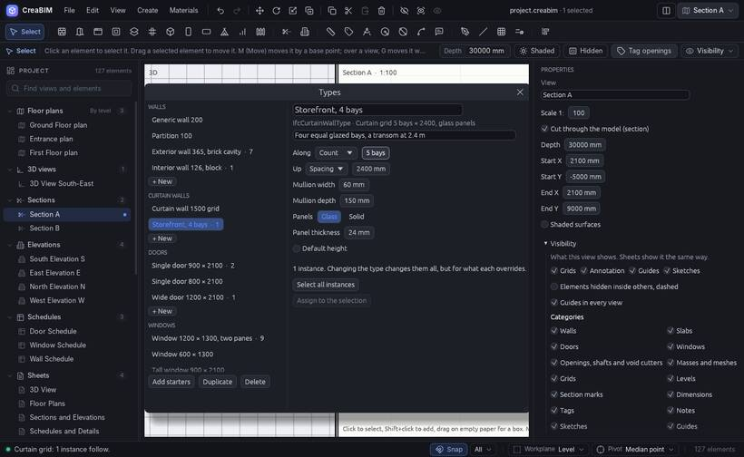

# Types

A **type** is a reusable definition that many elements share: "Exterior wall 365, brick cavity", "Window 1200 × 1300, two panes". The type holds the shared values (the build-up, the sizes, the frame, the curtain grid). Each element, an **instance**, keeps its own place and anything it overrides.

Change the type, and every instance follows, except where an instance overrides that value. Walls, curtain walls, doors, windows, slabs, roofs, columns and beams can have types.

## The Types window

Open it with *Materials › Types…*, *Create › Types…*, or the **⋯** on the browser's *Types* group.

- Types are grouped by kind, with how many instances each has.
- Edit a type's values on the right.
- *Add starters* adds a starter set; *Duplicate* and *Delete* below the list.
- *Select all instances* and *Assign to the selection* at the bottom.

## Drawing with a type

With the Wall, Door, Window, Slab, Roof, Column or Beam tool, pick a type in the **Type** menu at the start of the tool options. New elements are drawn as that type. Typing a size in the strip instead clears the type, since the size no longer matches it.

## An element's type

Select an element. In *Properties*:

- the **Type** picker swaps its type (for every selected element at once);
- change a value to **override** it; overrides are listed in orange;
- *Reset to type* drops the overrides, *Update type* writes them into the type;
- *Select all instances*, *Edit type…*;
- *Make a type of it* turns an untyped element into a new type.

A schedule can group its rows by type: tick *Group by type* in the schedule's *Properties*.
