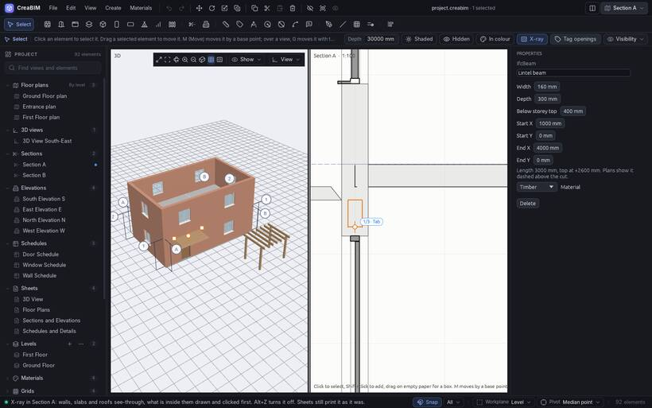

# Visibility and X-ray

## What a view shows

Each view keeps its own list of what it leaves out:

- whole **categories**: walls, slabs, doors, windows, columns, beams, roofs, stairs, railings, masses, void cutters, grids, levels, section marks, dimensions, tags, notes, sketches, guides;
- single **grid systems**;
- single **elements**.

Set it with the *Visibility* menu at the right of the tool options strip, or in *Properties* with nothing selected. Or right-click an element and pick *Hide in view* or *Hide category in view*. *Properties* lists the hidden elements, each with *Unhide*.

This is saved with the view and undoes like any edit. Sheets show each view the way it is set, so whatever a view hides is hidden on every sheet it is on.

## The 3D view

The 3D view has its own list: *Show* in its navigation buttons, or *View › 3D view visibility*. The quick switches come first: *All 2D objects*, *Grids*, *Annotation*, *Guides*, *Sketches*, *Void cutters*, *Ground grid*, *The 2D view in 3D space*, *X-ray*, *Hidden elements in colour*; then every category. Your choice is remembered.

Right-click an element in 3D and pick *Hide in 3D view* to leave it out of the 3D view only.

## Guides on and off

*View › Guides* (`Shift+G`) hides every guide in every view, without deleting them. Press it again, or pick the Guide tool, to bring them back.

## X-ray

X-ray lets you see, select and move what is buried inside other elements.

- **In 3D**: `Alt+Z`, the X-ray button in the navigation bar, or *View › X-ray*. Walls, slabs, roofs and masses turn see-through with their edges; beams, columns and the selection stay solid. Clicks take framing (beams, columns, members) before the walls round it.
- **In a plan, section or elevation**: `Alt+Z` with the pointer over the view, or *X-ray* in the tool options strip. Walls, slabs and roofs fade to faint fills, the elements they hide are drawn with solid lines and come first under the pointer, so you can select and drag them.

2D X-ray is a way of working: it isn't saved and never shows on sheets.

## Hidden elements

- **Hidden** (tool options strip, or *Elements hidden inside others, dashed* in a view's visibility) draws the edges of elements hidden inside or behind others with dashed lines: a beam in a wall, a column in a wall in plan, a slab edge behind a wall.
- **In colour** adds a see-through fill in each hidden element's material colour under its dashed lines, so a timber lintel in a wall reads as timber. Clicking inside the tint selects it. Turning it on also turns on *Hidden*.

Both are saved with the view and print on sheets, PDF and SVG. In 3D, *Hidden elements in colour* (in *Show*) draws buried elements in their colours, half see-through.

## Hiding for a moment

`H`, `Shift+H` and `Alt+H` hide and show for the session only. See [Copy, paste, delete and undo](edit#hide-and-show).
