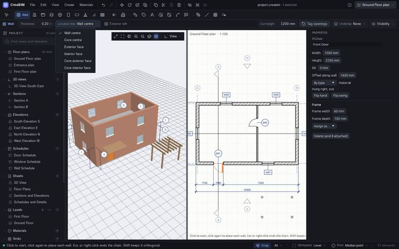
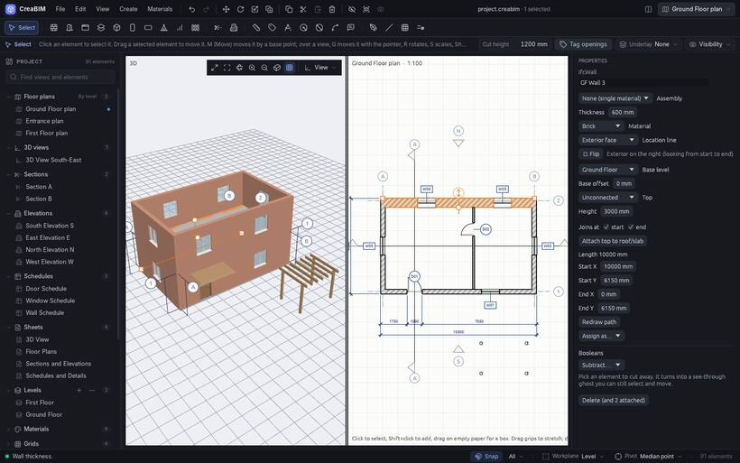

# Walls

## Drawing walls

1. Pick the **Wall** tool.
2. Set the options in the strip under the tools: its **Type** (or a **Thickness**), its **Location line** and **Exterior left**.
3. Click to start, then click each corner. `Esc` or right-click ends the chain. Click the first corner to close a loop.

Hold `Shift` to keep walls square. Walls snap to corners, midpoints and other walls, and can be drawn in plans, in sections and elevations (along the section line, as high as you draw it) and in the 3D view on the working level.

## Changing a wall

Select it, then:

- type new values in *Properties*: thickness, height, base offset, material, start and end;
- drag its square end grips, or the round handles in 3D for its height and faces;
- push or pull one face with [Move face](move#move-a-face-push-and-pull);
- *Redraw path* in *Properties* to click a new path for it.

## Location line

The **location line** is the line you draw the wall on. It can be the wall's centre, its exterior or interior face, or the centre or faces of its core (the structural layer of a [layered wall](assemblies)). The line stays where it is when the wall gets thicker, gets another assembly or is flipped.

For example, draw the outside walls on their **exterior face**: then making them thicker only grows them inwards, and the outside of the building stays put.

Pick it in the tool options before drawing, or in *Properties* afterwards.

## Inside and outside: flip

Every wall has an exterior side. While drawing, `Space` (or *Exterior left*) chooses which side of the line it goes on; a tick in the preview shows it. To flip a wall later:

- press `Space` with it selected;
- click the orange flip arrow beside it in the plan;
- use *Flip* in *Properties*, or *Flip wall* in the right-click menu.

The wall turns about its location line, and its doors and windows turn with it.

## Joins

Walls that meet join by themselves: an L corner is mitred (layer by layer for layered walls), a wall ending on another makes a T, and two walls that cross make a clean cross, the thicker one running through. Move or drag a wall and the walls joined to it follow.

To keep an end free:

- right-click near the end and pick *Disallow join at its end*, or clear *Joins at start / end* in *Properties*. The end stays square and isn't pulled along;
- or hold `Ctrl` or `Alt` while dragging an end grip to drag that end free.

## Base and top

A wall starts at its **base level** plus a **base offset**. Its **Top** is either:

- *Unconnected*: the wall has its own height;
- *Up to* a level, plus a *Top offset*: the wall's height follows that level when it moves.

**Attach top to roof/slab** (in *Properties* or the right-click menu) makes the top follow the underside of the roof or slab above, cut to its slope. Gable walls then stop neatly under the roof. *Detach* undoes it.

## Types and layers

A wall can be an instance of a **wall type**, which holds its build-up, so changing the type changes every wall of it. See [Types](types) and [Layered assemblies](assemblies). A wall with a curtain grid is a [curtain wall](curtain-walls).

## Screen walls

A **screen wall** is a wall built from a repeating pierced unit: breeze blocks, louvres or a lattice. Pick *Create › Site › Screen wall* and draw it like any wall. The holes come from the wall's type, so every screen wall of a type has the same pattern, and they show in plans, sections and 3D. The starter types are *Screen, breeze block 400 × 200*, *Screen, timber louvres* and *Screen, lattice 150*. A screen wall exports to IFC with its holes cut in its shape.
