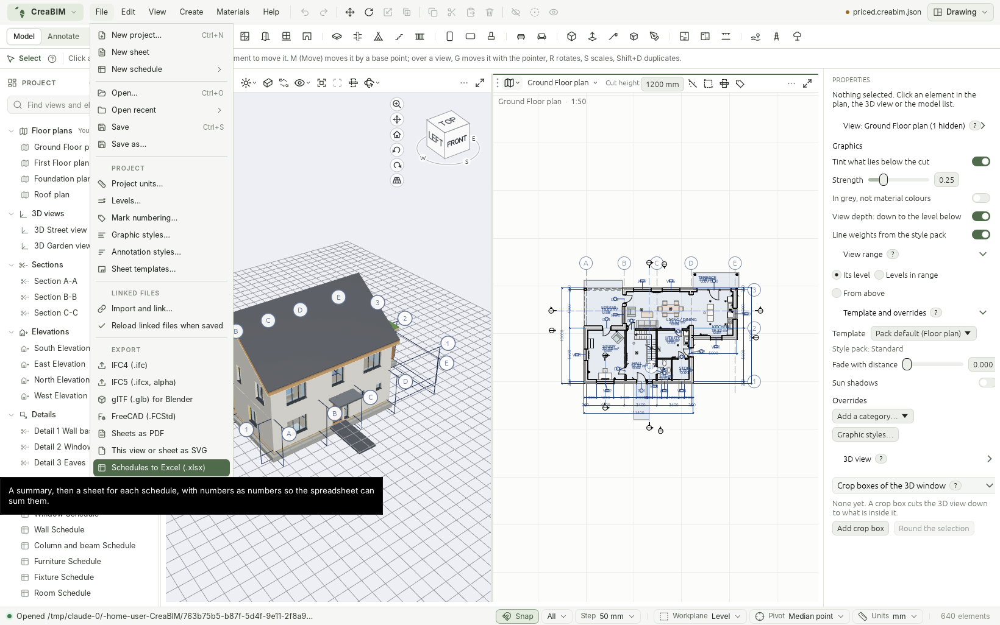
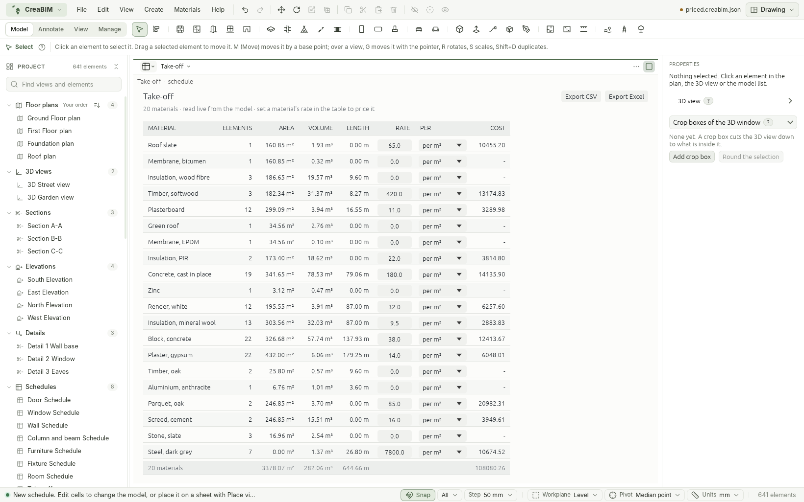
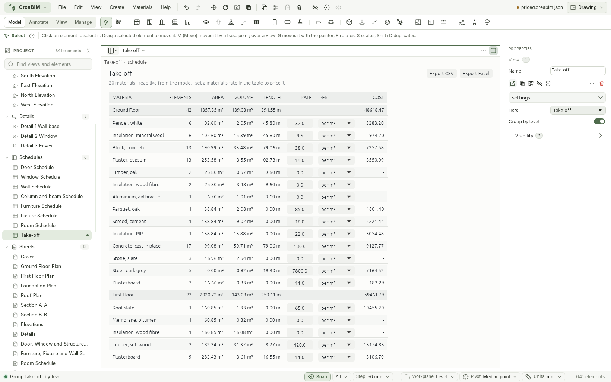
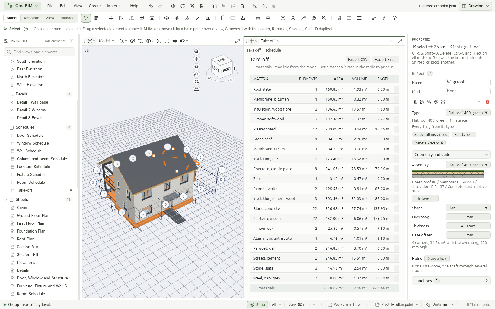
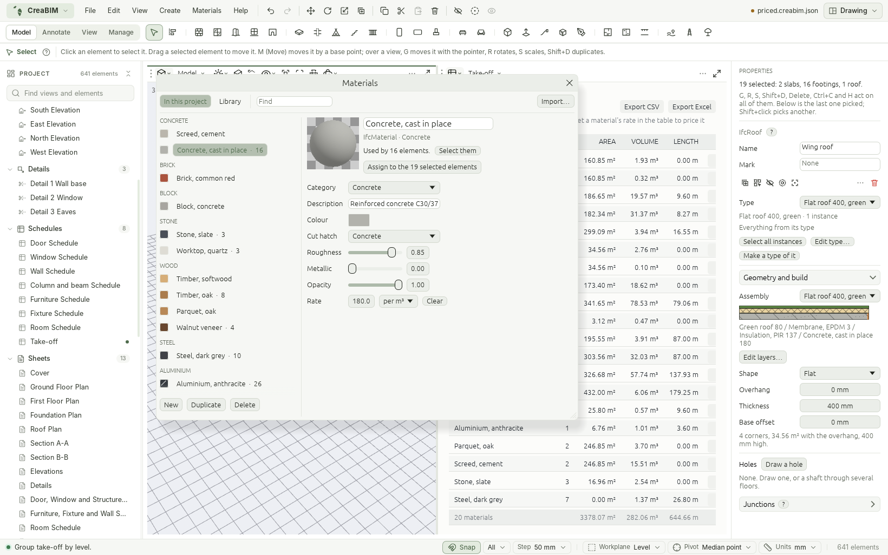
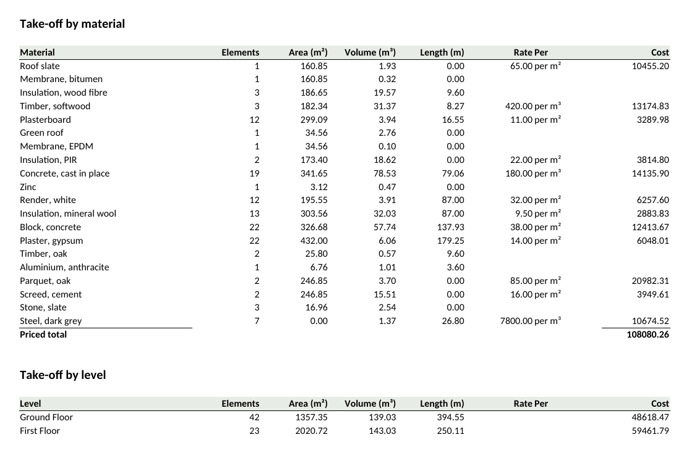
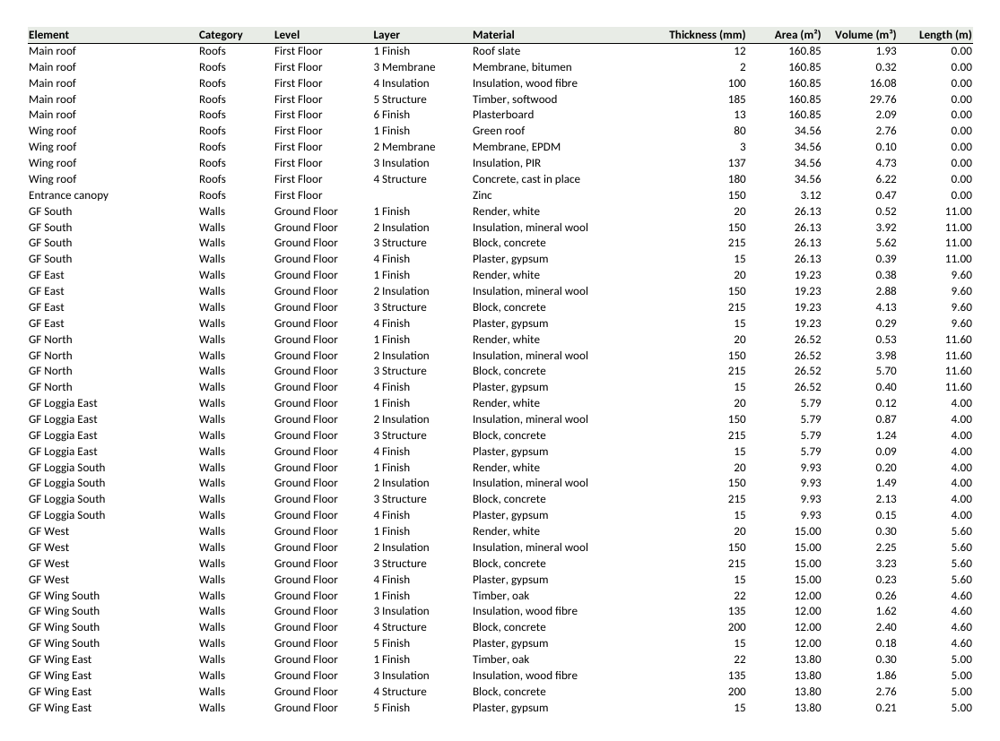
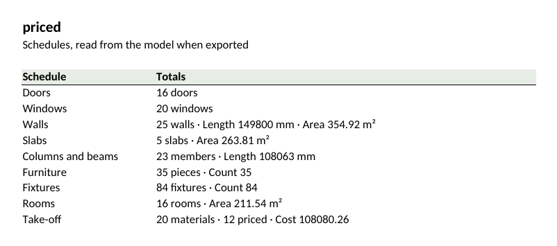
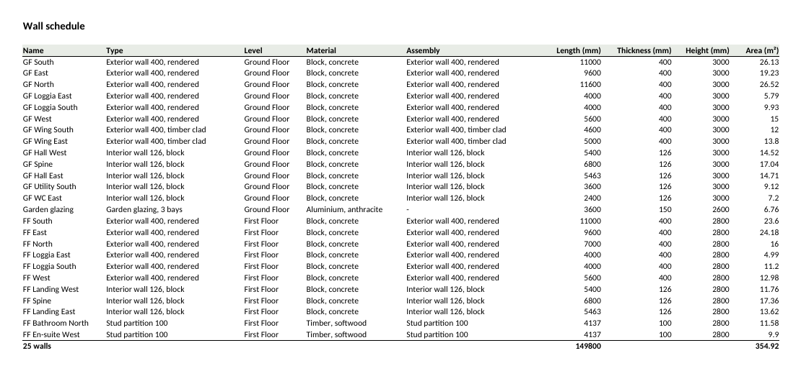

# Brief 02, Phase 4: heavy modelling

Reference screenshots for Phase 4 of *CreaBIM brief 02: consolidated* (2026-11-04), as the owner amended it on 2026-11-05. The items come one at a time, in this order:

1. layer editing in plan, section, 3D and any other useful view, such as callouts;
2. drawing on any face, with align, mirror, offset, move, rotate and the other manipulations there;
3. edge offset in 3D and 2D;
4. take-off;
5. image and PDF references;
6. profiles;
7. curved walls.

Items move from [docs/KNOWN_GAPS.md](../../KNOWN_GAPS.md#brief-02-2026-11-04) to its *Recently fixed* list as they land.

The screenshots were taken in the running app on a small L corner cut out of the starter house: two 400 mm walls of *Exterior wall 400, rendered* (render 20, mineral wool 150, block 215, plaster 15), 1.5 m each, with the plan and the 3D view side by side.

## Item by item

| Item | Part | Status |
| --- | --- | --- |
| 1 (3.7) | Wall layer ends: grips in Layers, drag or type, a dot on edited ends, reset one or all, kept through move, stretch and retype | **Done** (below). |
| 1 (3.7) | Slab and roof layer edges: a grip on each edge of each layer, drag or type, reset | **Done** (below). |
| 1 (3.7) | Corner join presets: Auto, Cores lap and finishes stop, This or the other wall runs through, Mitre every layer, Not joined | **Done** (below). |
| 1 (3.7) | *Draw by this line* on any layer boundary, without the wall moving | **Done** (below). |
| 1 (3.7) | Check model warnings for gaps and overlaps; IFC parts where layers differ | **Done** (below). |
| 1 (3.7) | Acceptance: an L corner, core 20 mm past, finishes stopping, in plan, section and 3D, the IFC in a second reader, moved with the edit kept | **Done** (below). |
| 2 (3.5) | Extrusion and void drawn on any face, keeping their plane; a void on a sloped roof cuts square to it | **Done** (below). |
| 2 (3.5) | Sweep path drawn on a face, its profile standing out of the face | **Done** (below). |
| 2 (3.5) | Slab on a level face; wall opening drawn on a wall face | **Done** (below). |
| 2 (3.5) | Room outline and detail region on a face | Not started: a detail region is drawn in its section or detail view already, and a room follows its walls. |
| 2 | Align, mirror, offset, move, rotate on the face | **Done** (below): new Mirror and Offset commands, in plan and on a face; Move, Rotate and Align follow a face workplane; push/pull on an extrusion drawn on a face. |
| 3 (3.6) | Edge palette on a selected element's outline edge, in 3D and plan: Offset edge, Offset all, Insert point | **Done** (below). |
| 3 (3.6) | Drag with snaps, or type a distance | **Done** (below). |
| 4 (5.1) | Schedules to Excel: one sheet per category plus a summary | **Done** (below). |
| 4 (5.2) | Quantities per assembly layer (m², m³) | **Done** (below). |
| 4 (5.2) | A rate per unit on each material, entered by the user | **Done** (below). |
| 4 (5.2) | A live Take-off pane, with totals by material and by level | **Done** (below), as a new kind of schedule. |
| 5–7 | | Not started. |

## 1. Layer editing

### Wall layer ends

Select a layered wall, press `Enter` for Edit mode, then `Tab`: **Layers**. Its own grips give way to one grip at each end of each layer, where its join puts that end. `Tab` again goes back to the wall's grips, and leaving Edit mode leaves Layers too.

The grip under the pointer names its layer and end ("Block, concrete: end"), and once moved, by how much.

Drag a grip along the wall to run the layer on past its join, or to hold it back. While dragging, `Tab` (or a digit) types the distance, as with every grip; `Enter` applies it.

After the drag, the moved end's grip is filled. Here the block runs 20 mm past the wall's free end, and the plaster is held back 50 mm from the corner. Plans, sections, callouts and 3D all draw the layers from the same pieces, so they all follow:

**How it is kept.** Each edit is an offset from where the join puts that layer's end, stored on the wall (`layer_ends` in the file, left out when there are none). So it stays through a move, a stretch, a slide, and a change of the other wall. Changing the wall's type keeps the edits of layers the new type also has; the others are dropped, and the status bar says how many.

**Reset.** Right-click a layer grip: *Reset layer end* puts that end back on its join, *Reset all layers* every end of the wall. Each is one undo step.

### Slab and roof layer edges

On a layered slab or roof, `Tab` in Edit mode shows a grip on each edge of each layer, at the middle of the edge and of the layer's depth. Drag one square to the edge, or type how far, to push that layer out past the element's edge or pull it in: a slate run on past the fascia, insulation stopped short of a slab edge. A roof's edges are its eaves and verges, and a pushed-out layer runs on down its own slope. In plan, where a slab's layers sit on one another, each layer's grip is drawn a step further out; in sections and 3D each is at its own depth.

Each edit is kept on the slab or roof (`layer_edges` in the file) as a distance square to that edge, so it moves with the edge when the outline is reshaped. *Reset layer edge* and *Reset all layers* are in the grip's right-click menu, and a change of type drops the edits of layers the new type lacks, as for walls.

**Gaps still open** (in [KNOWN_GAPS](../../KNOWN_GAPS.md)):

- A slab's arc edge is moved by its corners, so its bulge keeps its ratio rather than staying parallel.
- Adding or removing a corner of the outline renumbers its edges, and edits on edges after it move to the next edge.

- A layer run on by hand into the wall it meets overlaps that wall's layers, and the plan draws one over the other.
- While a grip is dragged, the preview is drawn without the joins of the walls around it.
- Grips of thin layers sit close together in plan at small scales: zoom in, or use the 3D view, where they are stepped up the end face.

### Corner join presets

Where a wall's end meets one other wall at a corner, right-click the wall near that end and pick *Corner join*, or use the row for that end at the top of *Properties › Junctions*. *Cores lap, finishes stop* is the corner the brief asks for: the finishes meet on the mitre, the stronger wall's core runs on to the far face of the other's core, and the other's core stops square against it. The preset is kept with the two walls, so it stays when either moves, and layer ends moved by hand are offsets from where the preset puts them.

### Draw by this line

Any line between two layers can be the wall's location line: the line it is drawn and dimensioned by, and that stays put when the wall gets thicker or its layers change. In Layers, right-click a layer's end grip and pick *Draw by its exterior face* or *Draw by its interior face*. *Properties › Location line* also lists every boundary by the layers it lies between. Only the location line changes: the wall does not move. The choice is saved in the file (`"location": "layer-boundary"` with `"boundary"`, counted from the exterior face) and written to IFC as the location line `LayerBoundary`.

### Check layer joins

*Create › Check layer joins* lists the walls with a layer moved by hand at an end where the wall meets another: held back, it leaves a gap; run on, it overlaps the wall it meets. It selects them and names each layer in the status bar. A layer stopped short or run on at an end that meets nothing is left alone. `creabim check <model>` prints the same lines and fails when there are any.

### IFC parts

Where an element's layers are not all as its layer set puts them (a layer end or edge moved by hand, or cores lapped at a corner), the IFC export also writes each layer as an `IfcBuildingElementPart`: its own solid, named after the element and the layer, with the layer's material, aggregated by the wall, slab or roof. The element keeps its body and its layer set, for software that reads only those. An untouched model has no parts. `tools/validate_ifc.py` (IfcOpenShell) passes on the export, and builds every part's geometry.

The acceptance corner, exported and drawn from IfcOpenShell's own geometry (a second reader, not CreaBIM): the cores lap at the corner, the plaster stops 50 mm short of it, and the block runs 20 mm past the free end.

Reading the file back into CreaBIM takes each wall's layers from its layer set and skips its parts, so they don't come in twice; the edits they show are not read back yet (in KNOWN_GAPS).

### Acceptance

| Asked | Where |
| --- | --- |
| An L corner, the core 20 mm past, the finishes stopping | 03, 04, 13 (*Cores lap, finishes stop*), 19 |
| Shown in plan, section and 3D | 04, 05, 06, 07 |
| The IFC opened in a second reader | 19 (IfcOpenShell) |
| The wall moved afterwards, the edit kept | 08 |

## 2. Drawing on any face

In the 3D view, the Extrusion, Void, Sweep, Slab and Wall opening tools now draw on the face under the pointer. The first click starts on that face (or on the workplane, if one is set), and later corners stay on the same plane. Snaps only count when they lie on that plane. Before this change, a snap could jump to a corner hidden behind the face.

An extrusion or void drawn this way keeps its plane: `"plane"` in the file, with `base` and `height` measured along the plane's normal. A void cuts square into the face, as deep as *Depth on a face* (default 500 mm). An extrusion stands square out of the face.

A sweep drawn on a face stores the face's normal with its path (`"face_normal"` in the file). The profile's height runs along that normal, so a band can run up a wall and across it.

A slab can only go on a level face, and its top sits on that face. A wall opening is drawn on a wall face once the workplane is on that face. It becomes the rectangle around the outline, measured along the wall and up from its base. Without a workplane, a click places an opening as before.

Edit mode moves an extrusion's or sweep's corners on its own plane. Move and rotate take the plane with them, and a scale scales the outline on it.

### Mirror, offset, move, rotate and align on the face

Two new commands sit in the Edit menu, the right-click menu and the modify bar: **Mirror** and **Offset**. Both make a copy by default; Ctrl turns the copy off, so the original changes instead.

- **Mirror**: click two points for the mirror line. With a workplane on a face, the line lies on that face and the selection flips across it, so a part on a wall still stands out of the wall afterwards. Shift keeps the line to 15° steps from the plane's axes, and a typed angle sets it. In plan, it mirrors across a line in the level. Walls keep their outside out, and columns and objects are turned to match.
- **Offset**: the side of the pointer and its distance from the original set the offset; type a distance and press Enter, and Shift rounds to 50 mm. Walls, beams, grids, room separators, strip footings, railings, slabs, roofs, ceilings, shafts and extrusions offset in plan; a sketch, an extrusion drawn on a face and a sweep offset on their own plane. A closed outline grows or shrinks; a line moves sideways.
- **Move** with a workplane on a face slides along the face. **Rotate** turns about the face's normal, by the pointer or by typed degrees.
- **Align** with a workplane on a face turns the part on that face, so its edge runs parallel to the reference edge.
- **Push/pull** now works on an extrusion drawn on a face: its outer face makes it deeper or shallower square to the face, and a side face makes it wider.

### Acceptance

| Check | Result |
| --- | --- |
| A part drawn on the south wall face, mirrored across a line on the face, copy stands out of the wall | Pass (24, 25; test `a_part_on_a_face_mirrors_square_to_it_and_still_stands_out_of_it`). |
| A wall mirrored across a slanted line keeps its outside out | Pass (test). |
| Rotate 30° on the face workplane turns about the face normal | Pass (26; test). |
| Push/pull of a part on a sloped face gets deeper square to it | Pass (27; test). |
| Offset a slab by a typed 600 mm in plan | Pass (28, 29; test with a typed "1.5m"). |
| Align a part on a wall face to a sloped edge | Pass (test `on_a_wall_face_workplane_a_part_turns_on_it_to_a_sloped_edge`). |

**Gaps still open** (in [KNOWN_GAPS](../../KNOWN_GAPS.md)):

- Room outline and detail region on a face.
- The plan's 2D tools still draw in the level's plane, as before.
- An object (furniture, fixture) mirrored keeps its own shape: only its position and facing are mirrored. An asymmetric column is not mirrored either, only turned.
- Mirror and Offset reuse two existing icons for now; new icons wait for the owner's OK.
- Thin grey slivers can show in the 3D view while a workplane sits on a face.

## 3. Edge offset in 3D and 2D

Select an element with an outline: a slab, roof, shaft, site, railing path, sketch, detail region, or an extrusion or sweep. Let the pointer rest on one of the outline's edges, in the 3D view or in a plan or section, and a small palette opens beside the pointer with three choices:

- **Offset edge** pushes that edge out or pulls it in, square to itself. The neighbouring edges stretch to follow. This is the edge's grip, but driven from where it is, so nothing needs pressing and holding.
- **Offset all** grows or shrinks the whole outline by one distance, in place. It is the Offset command with the copy off, and Ctrl makes a copy instead.
- **Insert point** adds a corner on the edge where the pointer was, then moves it.

Each choice follows the pointer with the usual snaps (ends, middles, axes, grid lines). Typing a distance and pressing Enter sends it that far the way the pointer went, a click places it, and Esc stops. Insert point is two undo steps: the corner, then its move. Esc leaves the new corner on the edge. The palette stays open while the pointer is on it, and a corner grip under the pointer wins over it.

Also in this round: Mirror and Offset no longer use Ctrl for two things. Ctrl only switches the copy. Shift now keeps the mirror line to 15° steps and rounds an offset to 50 mm.

### Acceptance

| Check | Result |
| --- | --- |
| Hover a slab edge in plan and in 3D: the palette shows | Pass (30, 37). |
| Offset edge by a typed 600 mm: only that edge moves, and the area grows by edge × 0.6 | Pass (31, 32, 38, 39; test `the_edge_palette_offsets_an_edge_offsets_all_and_moves_an_inserted_point`). |
| Offset all by 300 mm in place: no copy, every edge out | Pass (33, 34; same test). |
| Insert point, then 500 mm out with snaps | Pass (35, 36; same test). |

**Gaps still open** (in [KNOWN_GAPS](../../KNOWN_GAPS.md)):

- A wall has no outline edges here. Its faces push and pull with Move › Face, and its ends with their grips.
- The palette uses words, not icons. Icons wait for the owner's OK.

## 4. Take-off

Shots 40 to 44 are the starter house with rates typed on 12 of its 20 materials. Shots 45 to 48 are the Excel file it exports, opened in a spreadsheet program and printed.

**Excel export.** *File › Export › Schedules to Excel (.xlsx)*, or **Export Excel** beside *Export CSV* on any schedule, writes one workbook. It holds a *Summary*, a sheet for each schedule that lists something, then *Take-off* and *Take-off lines*. Numbers go in as numbers, with their unit in the column heading ("Width (mm)", "Area (m²)"), so the spreadsheet can sum and sort them. Text columns, such as room numbers like 0.10, stay text. Each sheet prints landscape, one page wide, with its headings repeated. On the command line, `creabim xlsx <model> <out.xlsx>` writes the same file.

**Quantities by layer.** Walls, slabs, roofs, ceilings, columns, beams and footings each give a line per material:

- an element with an assembly gives a line per layer, leaving out an air gap with no material;
- anything else gives one line.

Each line has an area: a wall's face less its doors and windows, a slab's or ceiling's plan area less holes, or a roof's slope area. It also has a volume (area × layer thickness, or section × length), a length for walls, members and strip footings, and a count.

**Rates.** A material has a *Rate*: a number per m², m³, m or piece, in the Materials window or in the take-off table. *Clear* takes it away. The rate is saved with the material and goes through the JSON format (`rate`, `rate_per`).

**The Take-off pane.** *New schedule › Take-off* opens a table read live from the model, like the other schedules. It has a row per material with its element count, area, volume, length, rate and cost, and the priced total at the bottom. *Group by level* puts each level's materials under a heading with that level's totals. A click on a material's name selects everything made of it. The rate and its unit can be edited in the table.

### Acceptance

| Check | Result |
| --- | --- |
| The workbook opens in a spreadsheet program, with a summary and one sheet per listed schedule | Pass (45 to 48; read back with a second program, and test `the_workbook_has_a_summary_and_a_sheet_per_listed_schedule`). |
| A layered wall gives one line per layer, each covering the face, with its own volume | Pass (46; test `a_layered_wall_gives_a_line_per_layer_whose_volumes_add_up`). |
| A rate prices its material, and the levels' costs add up to the total | Pass (41, 42; test `rates_cost_out_totals_by_material_and_by_level`). |
| A rate is saved, and a material without one saves as before | Pass (test `a_rate_survives_saving_and_a_material_without_one_saves_as_before`; JSON format round trip). |

**Gaps still open** (in [KNOWN_GAPS](../../KNOWN_GAPS.md)):

- Stairs, railings, parts (extrusions and sweeps), masses, doors, windows and placed objects are not in the take-off yet. Objects are counted in the Furniture and Fixtures schedules.
- A wall's area is its length × height less openings. It is not trimmed where walls meet, and a layered wall's layers all take the same face area.
- Rates have no currency symbol, and there is one rate per material, not per element type or per layer use.
