# Phase 1: levels, underlay and units

This phase adds three things:

- **Levels you can manage the way Revit does.** Add, duplicate, rename, re-height and delete levels. Draw and drag level lines in sections and elevations.
- **An underlay for plans.** A plan can show another level faintly underneath it, and you can snap to that level's lines.
- **Project units.** Choose metric or imperial, and every field, readout, dimension, tag, schedule and sheet uses that choice.

All screenshots are taken from the sample house (File > New sample house).

| | Screenshot | What it shows |
|---|---|---|
| 1 | 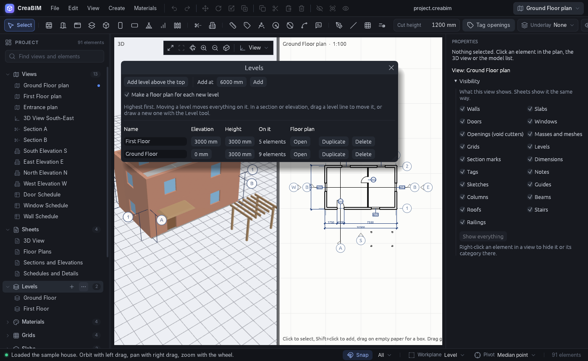 | **Levels manager**. Open it from the tree's Levels group (the `…` button), from Create > Levels…, View > Levels… or File > Levels…, or from the "Levels…" button in a level's properties. Each level is listed highest first, with its name, elevation, height, how many elements sit on it, and buttons to open or make its floor plan, duplicate it or delete it. |
| 2 | 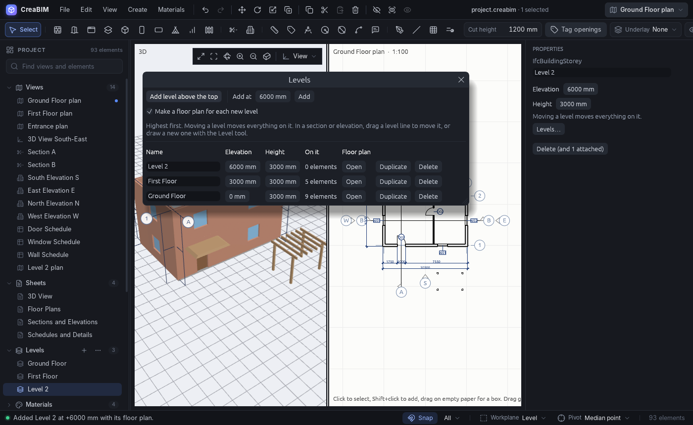 | **Adding levels**. "Add level above the top" puts a new level one storey above the highest one. "Add at" puts it at an elevation you type. If "Make a floor plan for each new level" is ticked, the level comes with its own floor plan view. The `+` button on the tree's Levels group and Create > "Level above the top one" do the same. |
| 3 | 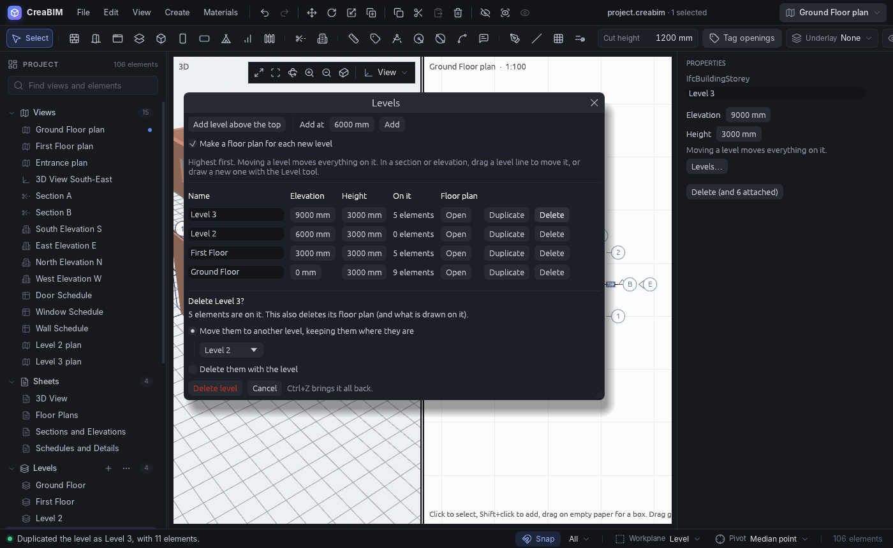 | **Deleting a level asks what happens to what is on it**. You can move those elements to another level and keep them where they are (their offsets are recalculated), or delete them along with the level. Ctrl+Z brings everything back. |
| 4 | 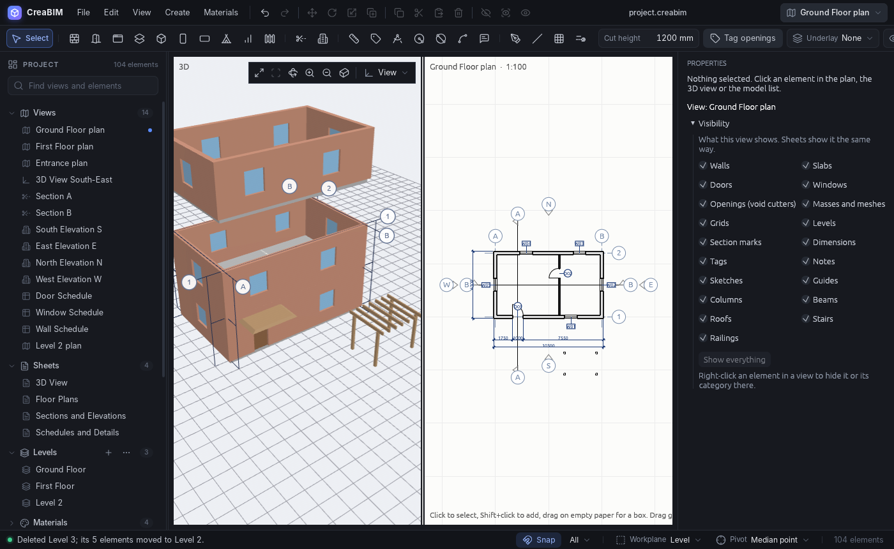 | After deleting Level 3, its five elements now sit on Level 2 at the same height in the model. |
| 5 | 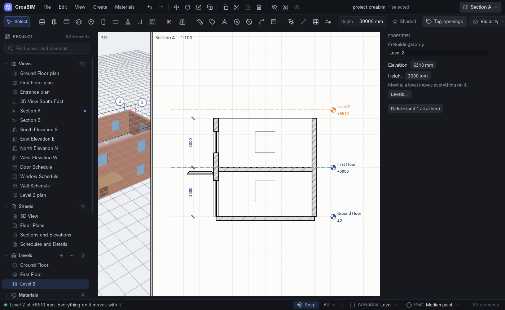 | **Level lines in Section A** have a Revit-style head showing the name and elevation. Drag a level line or its head to move the level and everything on it. The drag snaps to model points and otherwise rounds to 1 cm (or ½″ in imperial). The status bar shows the new elevation. |
| 6 | 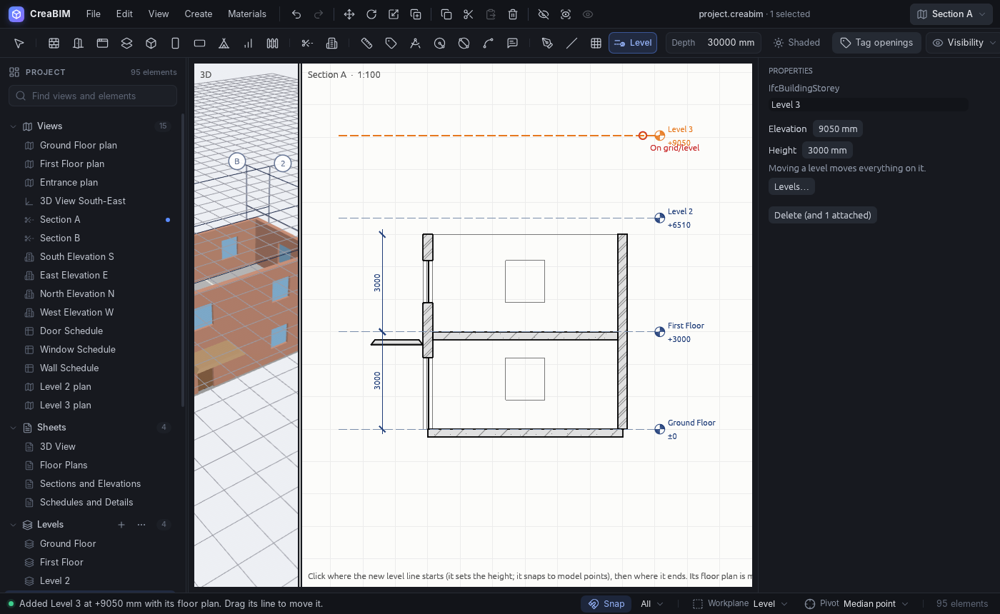 | **The Level tool**, in the toolbar next to Grid. In a section or elevation, the first click sets the height (it snaps to model points) and the second click ends the line. This creates "Level 3" at +9050 together with its floor plan. |
| 7 | 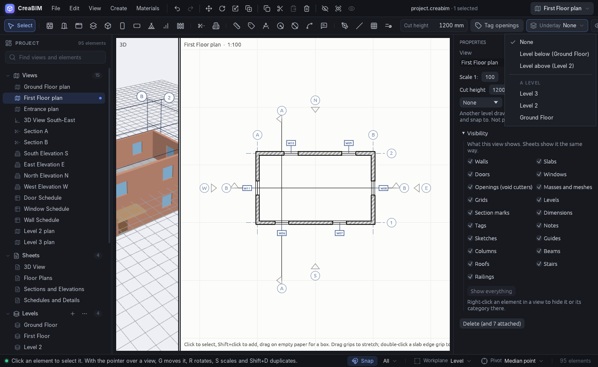 | **Underlay** in the options bar of a plan: None, Level below, Level above, or any other level. The same choice appears in the view's properties and under View > Underlay. |
| 8 | 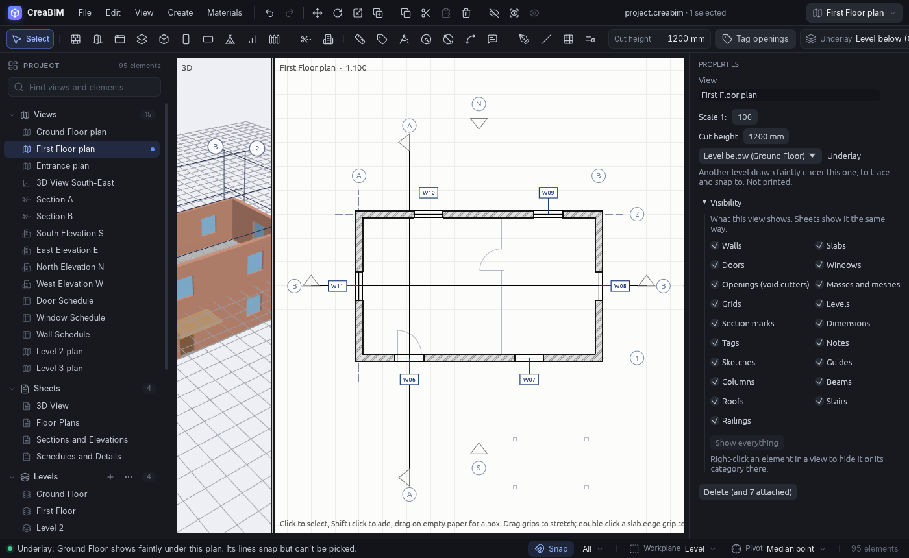 | The First Floor plan with the Ground Floor shown halftone underneath it: the partition, both doors, and the porch. |
| 9 | 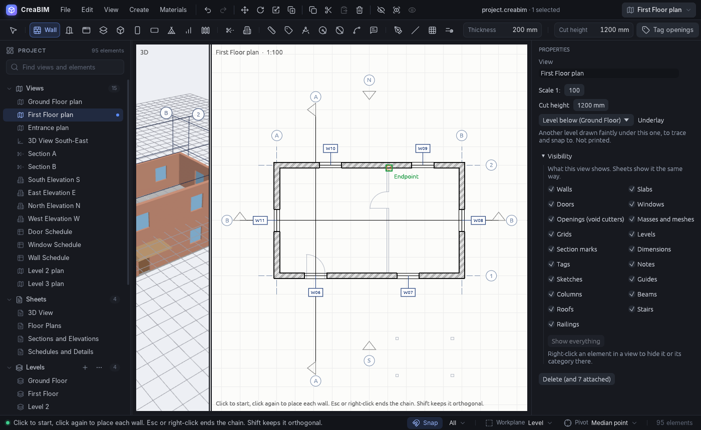 | The Wall tool snapping to an endpoint of the underlay's partition. Underlay lines can be snapped to but cannot be selected. |
| 10 | 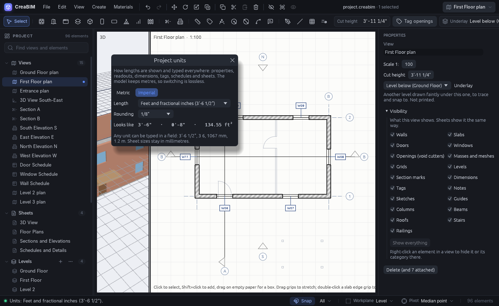 | **Project units** (File > Project units…). Choose Metric or Imperial, a length unit (mm, cm or m; feet and fractional inches, decimal feet, or inches) and the rounding or decimals, with a live preview. Fields immediately change to the new units. Here the cut height reads 3′-11 ¼″. |
| 11 | 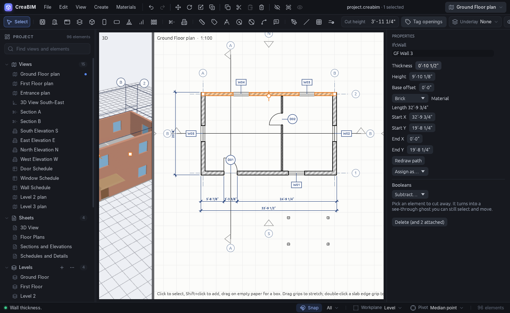 | An imperial project. Plan dimensions read 5′-8 ⅞″, 24′-9 ¼″ and 33′-9 ½″. Wall properties read in feet and inches. The thickness was typed as `10 1/2"`. |
| 12 | 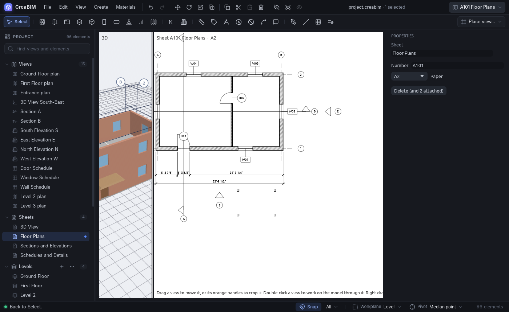 | The same dimensions on sheet A101. |
| 13 | 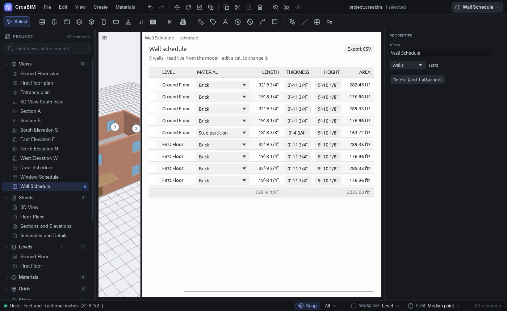 | The wall schedule in imperial. Lengths, thicknesses and heights are in feet and inches and can be edited the same way. Areas and the total are in ft². |

## How to try it

1. Run `cargo run --release -p creabim-app` and choose File > New sample house.
2. Click the `…` on the **Levels** group in the project tree, or choose Create > Levels…. Click **Add level above the top**, then **Delete** on the new level and choose what happens to what is on it. Press Ctrl+Z to undo.
3. Open **Section A**. Drag the "First Floor" level line up or down; the first floor moves with it. Pick the **Level** tool in the toolbar, then click once at a height and again to the side to draw a new level.
4. Open **First Floor plan** and set **Underlay → Level below** in the options bar. The ground floor appears faintly underneath. Pick the Wall tool and hover over the faint lines to see them snap.
5. Choose **File > Project units… → Imperial**. Look at the plan dimensions, a sheet and the Wall Schedule. Type lengths in any form into any length field, for example `3'-6 1/2"`, `3 6`, `42"`, `1067`, `1.2 m` or `120 cm`.

## Data

- **Units** are stored as a single `Units` element ("Project units") in the model, so changing them can be undone and is saved in both `.creabim` and JSON with nothing else to change. Files without that element open as metric (mm, 0 decimals). Internally the model is always in metres; only how values are displayed and read changes.
- **Underlay** is a new `View.underlay` field, `None | Below | Above | Level(id)`. It is serde-defaulted and skipped when `None`, so old files are unchanged.
- **Formatting and parsing** live in one place, `creabim_core::units`. The app uses it through `crate::units`, which holds the current project units each frame.
- **Level operations** are in `creabim_core::levels`: `add`, `duplicate`, `rename`, `set`, and `delete` with `OnDelete::{Delete, MoveTo}`. Each returns a single transaction, so one undo reverses it.

## Known gaps

- The underlay is shown on screen only. It is not printed on sheets, and it shows the other level's linework at this plan's cut height, without the other level's own view settings.
- Underlay `Level(id)` is a soft reference. If that level is deleted, the plan shows no underlay until another one is chosen.
- A level line runs across the whole section or elevation. Its ends cannot be dragged yet, and where you end the line with the Level tool doesn't matter.
- In plans, the Level tool only tells you to use a section or elevation.
- Duplicating a level always puts the copy one storey above the top level, not directly above the source.
- Paper sizes, viewport positions, text sizes and line weights stay in millimetres, which is the convention for sheets.
- Rehosting an element whose height follows its level, such as a column with no fixed height, makes it take the new level's storey height.
- The element count in the tree header includes the units element.
